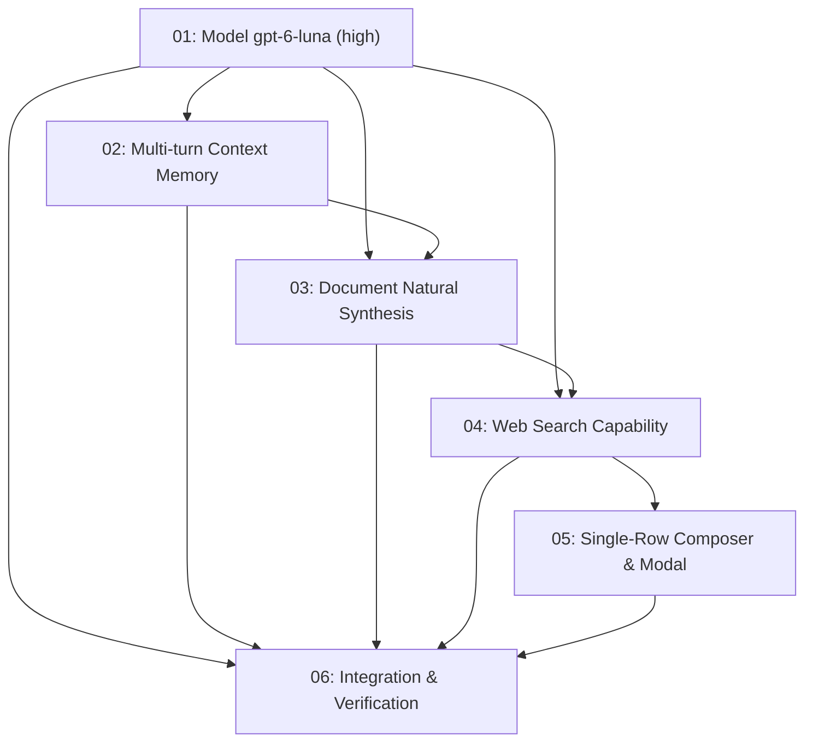

# Kế hoạch Nâng cấp Trợ lý AI (Assistant Enhancements Plan)

Bộ 6 ticket kỹ thuật được chia nhỏ theo phương pháp **to-tickets** sau quá trình phỏng vấn và thống nhất yêu cầu (**grill-with-docs**).

---

## 1. Tóm tắt Quyết định Thiết kế (Grill Decisions Receipt)

1. **Model**:
   - Sử dụng mô hình `gpt-6-luna` cho toàn bộ luồng hỏi đáp (Understander, Generation, Synthesis Verification).
   - Thiết lập `reasoning_effort: "high"`.
   - Ngân sách token linh hoạt để mô hình tự do suy luận và sinh câu trả lời đầy đủ, không bị lỗi cạn token suy luận.
2. **Chế độ Mở rộng kiến thức**:
   - Tự động bật mặc định (`knowledgeMode = "EXPANDED"`).
   - Chỉ khai thác tài liệu nội bộ (internal retrieved documents), KHÔNG tự ý tìm kiếm ngoài nếu chưa bật Web Search.
   - Cho phép AI diễn đạt câu từ tự nhiên, phong phú, trau chuốt (paraphrase mượt mà) và luôn gắn citation cho các thông tin thực tế lấy từ tài liệu.
3. **Tìm kiếm ngoài Web (Web Search)**:
   - Tích hợp OpenAI Web Search tool của mô hình.
   - Ghim icon Web Search trên thanh nhập câu hỏi: Khi click vào sẽ mở popup modal cảnh báo rủi ro dữ liệu web để người dùng xác nhận trước khi bật.
   - Khi tài liệu nội bộ không có thông tin: AI chủ động hiển thị nút gợi ý *"Tìm kiếm từ Web"* để người dùng kích hoạt nhanh chỉ với 1 click.
   - Mọi thông tin từ Web được gắn nhãn nguồn `source: "WEB"` kèm cảnh báo chưa qua kiểm duyệt.
4. **Bố cục Khung soạn thảo (Composer UI)**:
   - Thiết kế 1 hàng ngang (Single-Row): Textarea co giãn tự động nằm chung hàng với nút Gửi hình tròn/gradient bên phải.
   - Thanh công cụ phụ (chọn bối cảnh điểm đến, nút Web Search, đếm ký tự) nằm gọn gàng bên dưới.
5. **Bộ nhớ Ngữ cảnh Hội thoại (Multi-turn Context)**:
   - Bỏ giới hạn regex cứng của `needsHistory`, cho phép mọi câu hỏi tiếp nối trong phiên đều kế thừa ngữ cảnh.
   - Bổ sung cả câu hỏi và câu trả lời tóm lược của 2–3 lượt gần nhất vào prompt để AI ghi nhớ trọn vẹn mạch trao đổi.

---

## 2. Danh mục Ticket & Thứ tự Thực hiện

| Ticket | Tiêu đề | Mô tả tóm tắt | Phụ thuộc (Depends on) | Trạng thái |
|---|---|---|---|---|
| [01](issues/01-model-luna-high.md) | **Model Luna High** | Chuyển toàn bộ pipeline sang `gpt-6-luna` với `reasoning_effort: "high"`, cấu hình token linh hoạt | Không | Đã hoàn thành &amp; Kiểm chứng |
| [02](issues/02-multiturn-context-memory.md) | **Multi-turn Context Memory** | Sửa lỗi mất ngữ cảnh: lưu cả câu hỏi & câu trả lời lượt trước, nới lỏng bộ lọc lịch sử | 01 | Đã hoàn thành &amp; Kiểm chứng |
| [03](issues/03-auto-knowledge-grounded-synthesis.md) | **Document Natural Synthesis** | Auto bật mở rộng kiến thức, chỉ đọc tài liệu nội bộ, diễn đạt mềm mại, giữ trích dẫn citation | 01, 02 | Đã hoàn thành &amp; Kiểm chứng |
| [04](issues/04-web-search-capability.md) | **Web Search Capability** | Hợp đồng & tích hợp OpenAI Web Search tool, AI gợi ý tìm kiếm ngoài khi thiếu dữ liệu | 01, 03 | Đã hoàn thành &amp; Kiểm chứng |
| [05](issues/05-composer-single-row-web-modal.md) | **Single-Row Composer & Modal** | Nút Gửi cùng dòng ô nhập, ghim icon Web Search + Modal popup cảnh báo xác nhận | 04 | Đã hoàn thành &amp; Kiểm chứng |
| [06](issues/06-integration-regression-verification.md) | **Integration & Verification** | Kiểm thử tích hợp toàn diện, kiểm chứng đa lượt, responsive và chạy regression suite | 01, 02, 03, 04, 05 | Đã hoàn thành &amp; Kiểm chứng |

---

## 3. Sơ đồ Phụ thuộc (Dependency Graph)

