# Phản biện báo cáo khoá luận so với code thực tế

- **Báo cáo đối chiếu:** `D:\KLTN\KLHK1262720_BC_..._HOAN_CHINH.docx`, sửa lần cuối ngày 27/11/2026. Bản trích có 2.481 đoạn, 92 bảng và 113 hình.
- **Code đối chiếu:** repo `D:\KLTN\KLTN`, nhánh `master`, commit `c1f1e12`.
- **Ngày rà soát:** 28/11/2026.
- **Phạm vi:** chỉ đọc. Không sửa code, không sửa báo cáo, không chạy migration, không gọi production.
- **Quy ước:**
  - `M/` = `apps/web/src/modules/`, `A/` = `apps/web/src/app/api/`, `DB/` = `packages/db/prisma/`.
  - "KHÔNG TÌM THẤY" nghĩa là đã tìm mà không có bằng chứng; trường hợp này không được tính là khớp.
  - Sáu nhóm chủ đề do subagent đọc song song. Mọi phát hiện mức **Nghiêm trọng** đều được kiểm lại trực tiếp; các lệnh kiểm ghi ở mục 6.

---

## 1. Tóm tắt

**Mức khớp ước tính: khoảng 70%.** Cách tính: đếm khoảng 190 khẳng định có thể kiểm được (số liệu, tên hàm/bảng/enum, ngưỡng, luồng, quyền, công nghệ):
- khoảng 133 khẳng định khớp code;
- khoảng 35 khẳng định sai hoặc lệch;
- khoảng 22 khẳng định nói quá hoặc chỉ đúng một phần.

Phần lõi kỹ thuật được mô tả khá chính xác và có tên hàm thật:
- 54 bảng ở mục 4.2.5 khớp schema đến từng cột;
- 4 trigger;
- pipeline RAG (chunk 1600/200, `text-embedding-3-small` 1536 chiều, xen kẽ thứ hạng);
- Agent V2 có 4 kỹ năng, Trip Edit có 6 công cụ (theo Bảng 5.2);
- Idempotency băm SHA-256;
- khoá tài khoản thu hồi phiên;
- AES-256-GCM;
- nghỉ dọc đường 120/90 phút;
- 36 trang, 105 tệp route, 31 module, 21 enum.

Sai lệch tập trung ở số liệu tổng hợp, ở các câu "mọi/toàn bộ/tuyệt đối", và ở chỗ báo cáo tự mâu thuẫn giữa các chương.

### 10 lỗi nghiêm trọng cần sửa trước buổi bảo vệ

1. **Định tuyến và bản đồ mặc định là Stadia, không phải Google.** Báo cáo không nhắc Stadia lần nào và ghi "mặc định Google Routes" (FR14).
   - Code: `M/map/maps-provider.ts:4`; `M/trip-validation/stadia-route.ts:136` ghi "Stadia stays the default".
   - Tìm điểm xuất phát mặc định cũng dùng Stadia Geocoding (`M/trip-origin/origin-search-stadia.ts:19`). Nominatim chỉ còn là code cũ.
2. **Constraint Validator không có nhóm "Ngân sách" hay "Cấu trúc".** Mục 3.2.5, 4.1.3.3 và DFD 3.10 ghi như vậy.
   - Code có đúng 4 nhóm `openingHours | minimumDuration | travelTime | scheduleConflict` (`M/trip-validation/trip-validation.ts:21`).
   - Các mục 1.4.1 và 5.4.4 lại viết đúng, nên báo cáo đang tự mâu thuẫn.
3. **Kết quả kiểm thử ở Bảng 5.4 sai.** Báo cáo ghi "535 đã thực thi – 100%, 535 PASS".
   - `D:\KLTN\Test.xlsx` có 535 test case: **530 PASS, 5 CHƯA CHẠY** (cả 5 thuộc US-38, sheet SP5).
   - Trang Dashboard của chính file này còn ghi "Chưa có lượt manual execution nào được xác minh".
   - Phần Kết luận cũng nói còn 5 test case chưa chạy, mâu thuẫn với Bảng 5.4.
4. **RQ1/RQ2 được hứa ở mục 1.4.1 nhưng không có kết quả.** Báo cáo hứa đánh giá RAG và Validator so với LLM thuần túy, nhưng chương 5 không có số liệu nào.
   - Repo chỉ có bộ kiểm hồi quy dùng dữ liệu hư cấu (`M/ai/qa-evaluation.ts`) và đề xuất thí nghiệm (`docs/implementation/US-21-grounding-evaluation.md:75`).
5. **Số bảng và số migration sai.** Báo cáo ghi "54 bảng, 54/55 migration".
   - Code có **55 model**: bảng `destination_travel_time` bị bỏ sót (`DB/schema/destination.prisma:68-85`). Cộng 3 bảng nối ngầm là 58 bảng vật lý.
   - Có **56 migration**.
6. **Khẳng định "Admin bị chặn tuyệt đối dữ liệu riêng tư người khác" không đúng.**
   - `GET /api/admin/assistant-traces/[id]` trả toàn bộ hội thoại TripSage của bất kỳ người dùng nào.
   - Truy vấn chỉ lọc theo `id`, không lọc `userId` (`M/tripsage-chat/tripsage-tool-trace.ts:52-55`).
7. **Không có Playwright và không có tệp `*.spec.ts`.** Báo cáo ghi "528 tệp Vitest & Playwright, bao phủ toàn bộ 31 module".
   - 528 chính là số tệp `*.vitest.test.ts`. Ngoài ra còn 31 tệp node:test, tổng 559 tệp.
   - Module `system` không có test. Mục 1.4.2 ghi ">540", không khớp với 528 ở chỗ khác.
8. **TripSage có tối đa 23 công cụ, không phải 13+4.**
   - 15 công cụ nền (`M/tripsage-chat/tripsage-chat-tools.ts:2442`), 3 công cụ đọc thông tin (`tripsage-info-tools.ts`) và 5 công cụ theo cờ (`tripsage-extra-tools.ts`, `tripsage-memory/memory-tools.ts`).
   - Báo cáo cũng bỏ sót Firecrawl (công cụ `webSearch`/`fetchPage`).
9. **PostGIS chỉ được bật, chưa được dùng.** Báo cáo nói dùng PostGIS cho dữ liệu không gian địa lý.
   - Không có cột geography/geometry nào. Toạ độ lưu bằng `Float` (`DB/schema/destination.prisma:28-29`).
10. **Ba mô tả cơ chế sai:**
    - **Lập chỉ mục RAG không chạy bất đồng bộ.** Job chạy ngay trong request của admin (`A/admin/rag-documents/[id]/index/route.ts:9` ghi "Request-scoped, never durable").
    - **Ảnh Cloudinary không đi theo kiểu "trình duyệt tải thẳng có chữ ký".** Trình duyệt gửi tệp về máy chủ, máy chủ tự tải lên Cloudinary (`apps/web/src/lib/destination-image-client.ts:30`, `M/destination/cloudinary-provider.ts:75-87`).
    - **Điểm đến không có trạng thái `DRAFT/PUBLISHED`.** Code dùng `visibility HIDDEN/VISIBLE` cùng cột `deletedAt` (`DB/schema/destination.prisma:1-4,33-34`).

---

## 2. Bảng phát hiện

### 2.1. Mức Nghiêm trọng

| # | Vị trí trong báo cáo | Báo cáo viết gì | Code thực tế | Đề xuất sửa |
|---|---|---|---|---|
| 1 | 1.4.4; FR14; 2.2.1; 2.2.2; 3.2.2; 3.2.4; 3.2.5; 4.1.1.1; 4.1.4; 5.1.1; 5.3.1; 5.4.4; 5.5.2; 5.6.1; TLTK [8] | Định tuyến/bản đồ dùng "Google Routes computeRoutes", "mặc định Google Routes". Không nhắc Stadia. | Nhà cung cấp là `STADIA \| GOOGLE`, mặc định STADIA (`M/map/maps-provider.ts:4`, `apps/web/.env.schema:134`). Quản trị viên đổi được qua cấu hình runtime MAPS (`M/runtime-config/runtime-config-contract.ts:35`, `M/map/runtime-routing.ts:7-20`). Stadia dùng cho định tuyến `api.stadiamaps.com/route/v1` (`stadia-route.ts:82`), geocoding (`origin-search-stadia.ts:19`) và tile (`M/map/map-config.ts:2-4`). Google chỉ được gọi khi cờ là GOOGLE (`stadia-route.ts:138-141`). | "Bản đồ và định tuyến dùng một trong hai nhà cung cấp, cấu hình được lúc chạy: **Stadia Maps** (mặc định; nền MapLibre GL, Routing Valhalla `/route/v1`, Geocoding) hoặc **Google Maps Platform** (Maps JS, Routes v2 `computeRoutes`, Places). Mỗi thao tác dùng một nhà cung cấp cho mọi chặng; khoá định tuyến chỉ nằm ở máy chủ." Tách TLTK [8] thành hai mục: Stadia Maps và Google Maps Platform. |
| 2 | 3.2.5 (bước 2, nhóm 3–4); 4.1.3.3; DFD 3.10 (5.2 "chi phí"); 3.2.4 (đầu vào "ngân sách") | Validator gồm (1) thời gian & thứ tự, (2) di chuyển, (3) **ngân sách**, (4) **cấu trúc chặng** | `trip-validation.ts:21,46-51,183`: 4 nhóm `openingHours`, `minimumDuration`, `travelTime`, `scheduleConflict`; trạng thái `SATISFIED \| VIOLATION \| INSUFFICIENT_DATA`; `canConfirm` chỉ đúng khi cả 4 nhóm SATISFIED. TripRequirement không có trường ngân sách (`M/trip-requirement/trip-requirement-contract.ts:294-311`). Ngân sách chỉ là tư vấn trong TripSage (`M/tripsage-chat/tripsage-budget.ts:4-8`). | "Validator là mã tất định, không gọi AI, đánh giá 4 nhóm: (1) giờ mở cửa, (2) thời lượng tham quan tối thiểu, (3) thời gian di chuyển thực tế, (4) xung đột lịch trình. Mỗi nhóm nhận SATISFIED/VIOLATION/INSUFFICIENT_DATA; thiếu dữ liệu luôn là INSUFFICIENT_DATA." Bỏ "ngân sách/chi phí" khỏi 3.2.4, 3.2.5, 4.1.3.3 và DFD 3.10. |
| 3 | 5.7.2 Bảng 5.4; Hình 5.1–5.2 | "535 test case (535 đã thực thi – 100%), 535 PASS"; SP5 có 134 | `Test.xlsx`, đếm từng dòng: SP1 65, SP2 100, SP3 107, SP4 129, SP5 134 = **535**; **530 PASS, 5 CHƯA CHẠY** (SP5-38-005…). Dòng tổng ở Dashboard tự mâu thuẫn: dòng SP5 ghi PASS 65 / ĐÃ CHẠY 65. Tiêu đề Dashboard ghi "Chưa có lượt manual execution nào được xác minh". Banner sheet SP4 ghi "114 test case", sheet SP5 ghi "70 test case". | "Bảng theo dõi gồm 535 test case thuộc 49 User Story/Enabler; đã thực thi 530 (530 PASS, 0 FAIL, 0 BLOCKED), còn 5 test case Responsive của US-38 chưa thực thi." Cập nhật công thức trong Dashboard rồi chụp lại Hình 5.1–5.2. |
| 4 | 1.4.1 (mục tiêu cụ thể 5) | "đánh giá thực nghiệm hiệu quả của RAG (RQ1) và Constraint Validator (RQ2) so với LLM thuần túy" | Không có số liệu nào trong chương 5. Repo chỉ có kiểm thử hồi quy dùng fixture hư cấu (`M/ai/qa-evaluation.ts:12-13`) và 9 ca chạy thật (`docs/implementation/rag-advanced-live-results.json`, 9/9 đạt). Không có so sánh với LLM thuần. | **Cách 1:** bổ sung thí nghiệm (bộ câu hỏi, script, log, chỉ số độ hỗ trợ nguồn, tỉ lệ ảo giác). **Cách 2:** sửa mục tiêu thành "Thiết kế phương án đánh giá RQ1/RQ2; trong phạm vi khoá luận mới thực hiện kiểm thử hồi quy tự động, chưa có thí nghiệm đối chứng LLM thuần" và đưa vào phần Hạn chế. |
| 5 | 1.4.2; 4.1.1.1; 4.1.5; 4.2.1; 4.2.1.2; 5.1.1; 5.1.2; Kết luận; Hình 4.1–4.2 | 54 bảng; 54 migration (1.4.2, 5.1.2) / 55 migration (4.1.1.1, 4.1.5) | 55 model, mỗi model có `@@map`. Thêm 3 bảng nối ngầm `_AreaToCultureContent`, `_AreaToDestination`, `_CommunityToCultureContent` (`DB/migrations/20261012150000_admin_content_profiles/migration.sql:100-121`), tổng 58 bảng vật lý. 56 thư mục migration. Bảng thiếu: `destination_travel_time` (`DB/schema/destination.prisma:68-85`, migration `20261125121200_destination_travel_time`), đang được dùng ở `M/trip-planner/destination-travel-cache.ts:53-67`. | "CSDL gồm 55 bảng nghiệp vụ (cộng 3 bảng nối nhiều–nhiều do Prisma sinh), 21 enum, 56 migration và 4 trigger." Thêm mục 4.2.5.55 `destination_travel_time`: PK ghép (fromDestinationId, toDestinationId, transport); 2 FK → destination ON DELETE CASCADE; các cột durationSeconds, distanceMeters, provider, fromRevision, toRevision, computedAt. |
| 6 | 1.2a; FR03; Bảng 2.2; 3.2.1 bước 2; 4.1.4; Bảng 4.2; 5.2.1 | ADMIN "tuyệt đối không được xem hoặc sửa dữ liệu riêng tư (chuyến đi, yêu thích, hội thoại) của người dùng khác" | Các API phía du khách lọc theo `userId` (`M/trip-read/trip-read-service.ts:311`, `favorite-service.ts:43`). Ngoại lệ: `A/admin/assistant-traces/[id]/route.ts:14-19` gọi `readConversationTrace` với `where: { id }`, trả về văn bản người dùng, văn bản trợ lý và input/output của công cụ. Chỉ dữ liệu công cụ bộ nhớ bị che (`tripsage-tool-trace.ts:31,35,52-55`). | "ADMIN không xem hay sửa được chuyến đi, yêu thích, bộ nhớ của người khác qua các API Du khách. Ngoại lệ có chủ đích: màn hình AI Tool Trace cho phép Quản trị viên đọc nội dung một hội thoại TripSage (dữ liệu công cụ bộ nhớ được che) để giám sát chất lượng." Nêu thêm điều này ở mục Hạn chế. Cách khác là sửa code để chỉ trả các phần `data-tool-trace`. |
| 7 | 1.4.2; 5.1.1 Bảng 5.1; 5.7.1; Bảng 5.4; Kết luận; Phụ lục B | ">540 tệp" / "528 tệp *.test.ts, *.test.tsx, *.spec.ts … Vitest & Playwright … bao phủ toàn bộ 31 module" | `git ls-files` cho 559 tệp test, tất cả nằm trong `apps/web`: 528 tệp `*.vitest.test.ts(x)` (`apps/web/vitest.config.mts:29`) và 31 tệp node:test chạy bằng tsx. 0 tệp `*.spec.*`, 0 tệp test trong `packages/`. Không có `@playwright/test` trong package.json nào. Module `system` không có test. Lần chạy gần nhất được ghi lại: "486 passed \| 40 skipped \| 1 failed (527 files)" (`docs/ai-progress.md:6514`). | "Bộ kiểm thử tự động gồm 559 tệp trong apps/web/src (528 tệp Vitest và 31 tệp node:test chạy bằng tsx), bao phủ 30/31 module." Bỏ Playwright. Nên dẫn số lần chạy thật. |
| 8 | 1.5.3; Bảng 3.1 F11; 3.2.3 bước 2; 4.1.3.1; Bảng 4.1; Bảng 5.2; Bảng 5.3 | "13 công cụ cơ bản + 4 mở rộng (budget, flights, hotels, memory) = 17" | 15 công cụ nền: recordTripInfo, findOrigin, confirmOrigin, suggestReplies, listDestinations, getDestinationInfo, estimateRoute, proposeItinerary, searchPlaces, addSuggestions, lookupLocalKnowledge, estimateCosts, planAccessLeg, webSearch, fetchPage (`tripsage-chat-tools.ts:2442`). 3 công cụ thông tin: getWeatherForecast, listMyTrips, getMyTrip (`tripsage-info-tools.ts:46,100,122`). 5 công cụ theo cờ: checkBudget, searchFlights, searchHotels (`tripsage-extra-tools.ts:520-524`) cùng rememberPreference, recallMemories (`tripsage-memory/memory-tools.ts:25,42`). | "TripSage Chat có 15 công cụ nền, 3 công cụ tra cứu thông tin (thời tiết, danh sách và chi tiết chuyến đã lưu) và 5 công cụ tuỳ chọn bật theo 4 cờ BUDGET/FLIGHTS/HOTELS/MEMORY, tối đa 23 công cụ." |
| 9 | Nhiệm vụ KL; 1.4.4; 4.1.1.1; 4.1.1.2; Bảng 5.1 | PostGIS lưu và xử lý dữ liệu không gian địa lý | Chỉ có `CREATE EXTENSION postgis` (`DB/migrations/20261001120226_enable_postgis_pgvector/migration.sql:1`). 0 cột geography/geometry (grep migrations và schema). Toạ độ là `Float` có CHECK miền giá trị (`DB/schema/destination.prisma:28-29`). Script của repo ghi "No domain schema uses PostGIS." (`apps/web/scripts/test-destination-images-postgres.mjs:34`). | "Phần mở rộng PostGIS đã được bật sẵn nhưng phiên bản hiện tại chưa dùng; toạ độ lưu ở hai cột latitude/longitude (DOUBLE PRECISION có CHECK miền giá trị), khoảng cách và thời gian lấy từ dịch vụ định tuyến và bộ đệm destination_travel_time." |
| 10 | 3.2.8 bước 4; F30; 5.5.4 | "luồng xử lý bất đồng bộ", "job lập chỉ mục bất đồng bộ" | Job chạy trong request POST của admin, ngân sách 240 giây, `maxDuration = 300` (`A/admin/rag-documents/[id]/index/route.ts:9-10`, `M/rag-index/rag-index-request-service.ts:13,68-70`). Job có lease 120 giây; khi bị ngắt, admin bấm RESUME hoặc RETRY (`apps/web/src/app/admin/rag/rag-index-panel.tsx:81`). Không có hàng đợi hay worker nền. | "Job lập chỉ mục được ghi bền vững (rag_index_job, lease 120 giây, chống chạy trùng) và thực thi đồng bộ trong request quản trị (tối đa khoảng 240 giây); khi bị gián đoạn, Quản trị viên tiếp tục bằng RESUME/RETRY từ checkpoint." |
| 11 | 5.2.4; 4.1.5; DFD 3.13 (8.2 "Yêu cầu chữ ký"); 5.3.2 | "Máy chủ cấp chữ ký … trình duyệt tải trực tiếp lên Cloudinary" | Pha 1 `POST …/images/intents` ghi ý định tải: sha256, size, mime, publicId, hạn 30 phút (`M/destination/destination-image-service.ts:26-58`). Pha 2 trình duyệt POST byte về máy chủ (`apps/web/src/lib/destination-image-client.ts:30`). Máy chủ giải mã bằng Sharp (≤10 MB, ≤25 MP) rồi `upload_stream` (`cloudinary-provider.ts:39-49,75-87`), sau đó đọc lại và đối chiếu (`destination-image-service.ts:60-78`). | "Tải ảnh hai pha qua máy chủ: (1) ghi nhận ý định tải (mã băm, kích thước, định dạng, hạn 30 phút); (2) trình duyệt gửi tệp về máy chủ, máy chủ giải mã kiểm tra bằng Sharp, tự tải lên Cloudinary, đọc lại siêu dữ liệu để đối chiếu rồi mới ghi content_media (ADMIN_UPLOAD_V1)." |
| 12 | 3.2.2 (tiền điều kiện, ràng buộc); Bảng 4.2 | Điểm đến "status = PUBLISHED", "DRAFT" | `DestinationVisibility {HIDDEN, VISIBLE}`, mặc định HIDDEN, cùng cột `deletedAt` (`DB/schema/destination.prisma:1-4,33-34`). Điều kiện công khai: `{visibility:"VISIBLE", deletedAt:null}` (`M/destination/destination-eligibility.ts:6`). Nháp/xuất bản chỉ có ở Editorial, dạng JSON `draft`/`published`. | "Điểm đến công khai khi visibility = VISIBLE và chưa xoá mềm (deletedAt = null); điểm đến HIDDEN hoặc đã xoá mềm không hiển thị (truy cập trực tiếp trả 410)." |
| 13 | 4.1.4 "Bảo vệ bí mật"; 5.6.1 | "Khoá OpenAI và Google Routes … tuyệt đối không dùng tiền tố NEXT_PUBLIC_" | Có `NEXT_PUBLIC_GOOGLE_MAPS_API_KEY` (khoá Maps JS cho trình duyệt), `NEXT_PUBLIC_GOOGLE_MAPS_MAP_ID` và `NEXT_PUBLIC_MAPS_PROVIDER` (`apps/web/.env.schema:133-141`, dùng ở `M/map/google-maps-sdk.ts:32`). Khoá máy chủ là `GOOGLE_MAPS_API_KEY` và `STADIA_MAPS_API_KEY` (`.env.schema:128-146`). | "Khoá OpenAI, khoá Google Routes/Places phía máy chủ (GOOGLE_MAPS_API_KEY) và khoá Stadia chỉ tồn tại phía máy chủ. Riêng NEXT_PUBLIC_GOOGLE_MAPS_API_KEY là khoá Maps JavaScript công khai cho trình duyệt, được giới hạn theo HTTP referrer." |
| 14 | 1.4.3; 4.1.3.3; 5.2.2; NFR06 | "Mọi thao tác ghi quan trọng" và "áp dụng thống nhất từ giao diện đến máy chủ" Idempotency-Key | Khoảng 50/76 endpoint ghi có dùng (ước lượng từ việc rà tay các adapter). Các endpoint ghi không dùng: `POST/DELETE /api/trips/[id]/edits/ai/messages` (`M/trip-edit/trip-edit-chat-memory.ts:214-262`), `POST/DELETE /api/ai/session`, `DELETE /api/ai/conversations/[id]` (`M/ai/qa-http.ts:93-99`), `POST /api/session/logout`. Client không tự động thử lại (`apps/web/src/lib/mutation-client.ts:60-109`). | "Các thao tác ghi nghiệp vụ chính (lưu, xoá, ghim, chỉnh sửa chuyến; yêu thích; quản trị người dùng; cấu hình runtime; nhóm đồng hành; điểm đến/RAG) dùng hợp đồng SUCCESS/FAILED/UNKNOWN với Idempotency-Key; lịch sử chat chỉnh sửa, phiên khách Q&A và đăng xuất dùng cơ chế riêng." |
| 15 | 3.2.3 bước 1–2; DFD 3.8; 5.5.1 | Hỏi đáp RAG và TripSage được mô tả là một luồng; trợ lý nổi trả lời streaming và dùng TravelerMemory | **Hai luồng riêng.** (a) `/api/ai/ask` (`M/ai/qa-runtime.ts:28`): dành cho khách và trợ lý theo điểm đến; trả JSON, không streaming (`qa-http.ts:84`); có SOURCE_ONLY, kiểm trích dẫn, `FOR UPDATE`; không dùng bộ nhớ. (b) `/api/ai/chat`: chỉ cho du khách khi bật cờ; RAG chỉ là công cụ `lookupLocalKnowledge`; khi không có tài liệu, mô hình được dặn trả lời bằng hiểu biết chung (`tripsage-chat-tools.ts:2162-2246`). | Tách 3.2.3 thành hai tiểu mục: "Hỏi đáp RAG có kiểm trích dẫn" và "TripSage Chat gọi công cụ"; vẽ lại DFD 3.8 theo bản sửa ở mục 4.3. |
| 16 | 3.3.2 Hình 3.5 so với Bảng 3.4/3.5 | 7.0 là Bạn đồng hành, 8.0 là Quản trị; 9 kho D1–D9 | Hình vẽ 7.0 là Quản trị, 8.0 là Đồng hành; chỉ có 8 kho với mã khác bảng, không có D9. Hình có tác nhân "Dịch vụ tra cứu giá và web" mà DFD0 không có, nên DFD0 và DFD1 không cân bằng. Kho D7 "Kết quả kiểm tra ràng buộc" không tồn tại trong CSDL: chỉ có `Trip.uncheckedChecks` (`DB/schema/trip.prisma:18-21`). | Vẽ lại DFD1 theo mục 4.3; bỏ D7; chuyển Tool Trace sang kho Hội thoại. |
| 17 | Hình 4.31 | "Mô hình quan hệ – Tài liệu tri thức và cấu hình" | Ảnh có nội dung giống hệt Hình 4.30 (cụm Chuyến đi). Không có hình RM nào cho 8 bảng `rag_*` và nhóm cấu hình. | Vẽ RM cho cụm RAG và cấu hình (dùng lại phần tương ứng của ERD ở mục 5). |
| 18 | Hình 4.3; Hình 4.27, 4.28, 4.30 | Hình 4.3: Bài đồng hành **N–1** Người dùng. Hình 4.27/4.28/4.30: các quan hệ 1–1 vẽ thành 1–N | `trip_companion_membership` có PK (publicationId, userId), tức M–N (`DB/schema/trip.prisma:89-101`). `assistant_planning_workspace.conversationId` là PK đồng thời FK; `destination_editorial.destinationId` là PK đồng thời FK; `trip_companion_publication.tripId @unique`. Các quan hệ này là 1–0..1. | Sửa bội số Hình 4.3 thành M–N; đổi ba quan hệ ở Hình 4.27/4.28/4.30 thành 1–0..1. |

### 2.2. Mức Trung bình

| # | Vị trí | Báo cáo viết gì | Code thực tế | Đề xuất sửa |
|---|---|---|---|---|
| 19 | 3.2.1 ràng buộc | Tài khoản "INACTIVE/SUSPENDED" | `UserStatus {ACTIVE, LOCKED}` (`DB/schema/auth.prisma:6-9`); guard kiểm LOCKED (`apps/web/src/server/authorization/guard.ts:24`) | "Nếu tài khoản LOCKED, hệ thống từ chối tạo phiên (hook session.create.before và trigger session_requires_active_user) và mọi API bảo vệ trả 403 ACCOUNT_LOCKED." |
| 20 | 3.2.7; 4.1.3.4 | Trạng thái huỷ nhóm "CANCELLED" | Không có enum này. Huỷ được lưu bằng cột `canceledAt` (`trip.prisma:69`), có CHECK `companion_cancellation_stops_recruitment` và trigger `trip_companion_terminal_cancellation` (`DB/migrations/20261028141000_companion_cancel/migration.sql:1-12`) | "Huỷ được ghi một lần bằng mốc canceledAt; trigger cấm thay đổi mốc này, CHECK buộc ngừng tuyển." |
| 21 | 4.1.1.1 / 4.1.2.1 / 5.1.2 | "132 endpoint" và "139 hàm xử lý" | 132 handler khai báo tường minh, cộng 2 handler (GET/POST) của catch-all `A/auth/[...all]/route.ts:5`, tổng **134**: GET 57, POST 52, PATCH 12, DELETE 12, PUT 1 | "105 tệp Route Handler, 134 hàm xử lý HTTP." |
| 22 | 5.1.2; Kết luận | "1.060 tệp mã nguồn production" | Không tái lập được con số này. Tệp .ts/.tsx không phải test trong `apps/web/src` + `packages/*/src` = 942–944; thêm mts/mjs/js = 1.020; thêm css = 1.076 | Ghi rõ định nghĩa, ví dụ "944 tệp .ts/.tsx không tính test và mã sinh tự động". |
| 23 | 4.1.1.1; 5.1.2 | "hơn 100 thành phần @KLTN/ui"; "141 thành phần" | `packages/ui/src/components` có 17 tệp; `apps/web/src/components` có 125 tệp ts/tsx (98 tsx) | Sửa lại số liệu. |
| 24 | 5.1.1 | "Turborepo, pnpm" | `package.json:44` ghi `"packageManager": "npm@11.16.0"`; có `package-lock.json` và `bun.lock`; không có pnpm-lock | "Turborepo, npm workspaces". |
| 25 | 4.1.5; 5.2.6 | Cron định kỳ (ngầm hiểu là Vercel Cron) | `vercel.json` không có `crons`. Lịch nằm ở GitHub Actions `.github/workflows/us21-qa-retention-cleanup.yml:5` (`17 * * * *`), cộng một workflow heartbeat | "GitHub Actions gọi GET /api/internal/qa-cleanup mỗi giờ (CRON_SECRET, ghim host/DB) để dọn hội thoại Q&A, bản ghi chống lạm dụng và hội thoại trợ lý quá hạn." |
| 26 | 5.4.4; FR14 | `scheduleConflict` trong khung 08:00–18:00; timeout 40 giây | Khung 08–18 chỉ kiểm khi lập và lưu (`M/trip-planner/planner-engine.ts:12`, `planner-validator.ts:46-47`); `validateItinerary` lúc sửa/In-Trip không kiểm (`trip-validation.ts:158-178`). Timeout: 40 giây tổng cho mỗi thao tác lập lịch (`planner-routes.ts:15`); 10 giây khi lưu (`journey-save-validation.ts:129`) và In-Trip (`in-trip-validation.ts:118`) | Ghi đúng phạm vi áp dụng của từng ngưỡng. |
| 27 | 5.4.4 | `canConfirm` bật khi "… hoặc xác nhận UNCHECKED" | Khi còn UNCHECKED, `canConfirm` vẫn false; việc lưu đi qua `decideSave` và đòi danh sách xác nhận khớp với máy chủ (`M/trip-save/trip-save-service.ts:109-120`) | Tách thành hai câu như đề xuất của subagent: một câu về canConfirm, một câu về lưu sau xác nhận tường minh. |
| 28 | 3.2.4; 4.1.3.2; 5.4.3 | Thứ tự điểm = 2-opt `untangleRoundTrip` | Pipeline thật: (1) NN đa điểm khởi đầu, thêm 2-opt chỉ khi đã có origin (`planner-order.ts:33-73`); (2) `orderRoundTrip` dùng 2-opt + Or-opt (`planner-route.ts:33-69`); (3) DP `balanceJourneyDays` (`journey-planner.ts:278`) hoặc `balancePlannerDays` (`planner-day-balance.ts:17-64`) | Dùng đoạn mô tả ở mục 4.5. |
| 29 | 1.4.3; P05; 3.2.6 | "Khoá bất biến các điểm đã đi qua" | Một lượt bị coi là đã qua khi giờ kết thúc theo lịch ≤ giờ máy chủ (Asia/Ho_Chi_Minh), không dựa vào GPS (`M/in-trip/split-trip.ts`, `apply-edit.ts:164-166`) | "Khoá các lượt đã qua giờ kết thúc theo lịch (theo đồng hồ máy chủ, múi giờ Asia/Ho_Chi_Minh)." |
| 30 | 4.1.3.4 | 6 công cụ của Trip Edit có "kiểm chứng ràng buộc, hoàn tác undo" | `simulate_changes, search_destinations, get_weather, lookup_local_knowledge, apply_to_draft, show_options` (`M/trip-edit/trip-assistant-agent.ts:558-631`). Undo là ngăn xếp bản nháp 50 bước ở client (`edit-workspace-state.ts:9`). Bảng 5.2 ghi đúng | Ghi lại đúng 6 tên như Bảng 5.2. Hình 2.31: đổi "6 kỹ năng" thành "6 công cụ". |
| 31 | 3.2.3 bước 3; 4.1.3.1 | Bộ nhớ "tự động trích xuất", "tự động nạp vào ngữ cảnh" | Lưu bộ nhớ chỉ khi mô hình gọi `rememberPreference`; truy hồi khi gọi `recallMemories` (top-5, cosine ≥ 0,5); trần 100 mục (`M/tripsage-memory/memory-store.ts:9-12,67-75`, `memory-contract.ts:4`) | "Mô hình chủ động lưu sở thích bằng công cụ rememberPreference và truy hồi khi cần bằng recallMemories (pgvector cosine, tối đa 5 mục, ngưỡng 0,5)." |
| 32 | Bảng 4.2 "Đọc/Hỏi (giới hạn rate-limit)" | Khách bị giới hạn tần suất | Cơ chế đếm và lease có thật, nhưng mọi ngưỡng đặt 100.000.000 (`M/ai/qa-abuse.ts:16-20`), nên thực tế không giới hạn | "Có cơ chế đếm yêu cầu và lease theo mạng; ngưỡng hiện đặt rất cao, chưa siết thực tế." |
| 33 | 3.2.3; DFD 3.8, 3.13 | Tool trace ghi vào D9 (kho cấu hình) | Trace là phần `data-tool-trace` trong `assistant_message.parts` (`tripsage-tool-trace.ts:6-7`), tối đa 40 mục mỗi lượt, chỉ có ở TripSage | Chuyển luồng trace sang kho Hội thoại. |
| 34 | F13; 3.2.3 bước 4 | Agent V2 là dự phòng "khi tắt TripSage hoặc khi cần lập kế hoạch cấu trúc" | Chỉ du khách, chỉ khi cờ TripSage tắt (`components/assistant/assistant-runtime-chat.tsx:62-79`). Khách vãng lai dùng `/api/ai/ask`. Không có nhánh "khi cần lập kế hoạch cấu trúc" | Bỏ vế "khi cần lập kế hoạch cấu trúc". |
| 35 | 1.4.1; 5.4.1 | "chunking cho tiếng Việt"; "topK = 4, 3.000 token" | `structure-grapheme-v1` không tách từ; `Intl.Segmenter('vi', grapheme)` chỉ để không cắt hỏng ký tự (`M/rag-processing/chunk-document.ts:8-56`). Tham số truy hồi theo luồng: Q&A 4 / 3000 / minScore 0,25; TripSage 4 / 2000 / 0,38 (`tripsage-chat-runtime.ts:66`) | Ghi đủ thông số và nói rõ "không tách từ". |
| 36 | 3.2.8 dữ liệu đầu vào | "PDF/DOCX/TXT/Markdown" | Chỉ PDF, DOCX, TXT (`M/rag-document/rag-file.ts:18`, enum `RagDocumentFileType`) | Bỏ "Markdown". |
| 37 | 1.2c; 3.2.2 bước 3; 5.3.2 | Văn hoá bật/tắt qua "cờ tính năng" | Là hằng số `mvpFeatures.culture = false` (`apps/web/src/lib/mvp-features.ts:6`), phải build lại mới đổi được. `/culture` chuyển hướng về `/explore`, nhưng API `/api/culture` vẫn trả dữ liệu | "…ẩn giao diện công khai bằng hằng số trong mã nguồn (cần build lại để bật); API vẫn mở." |
| 38 | 1.2c; 5.6.3 | SerpApi **và Petrolimex** chạy theo cờ | SerpApi có cờ FLIGHTS/HOTELS; Petrolimex không có cờ, `estimateCosts` là công cụ nền và luôn tra giá xăng (`tripsage-chat-tools.ts:2261`) | Sửa câu cho đúng. |
| 39 | F05/F28; 3.2.2; 5.2.4; 5.3.1 | Editorial "V1/V2/V4" | Chỉ có `schemaVersion` 1 và 2 (`M/destination-editorial/editorial-contract.ts:41,141`). "V4" là tên nội bộ của pipeline AI (`editorial-ai.ts:498`) | "Hai phiên bản lược đồ bố cục V1/V2; pipeline AI thế hệ V4 sinh bố cục V2." |
| 40 | 3.2.2 đầu vào | Lọc theo "thẻ trải nghiệm" | Máy chủ chỉ lọc `q`, `category`, `region` (`M/destination/public-destination-list.ts:23-31`); client lọc thêm "mở cửa hôm nay" và sắp xếp. Lọc theo thẻ: KHÔNG TÌM THẤY | Sửa danh sách bộ lọc. |
| 41 | P07, Hình 2.34; F07 | Trang Yêu thích có cả văn hoá; kiểm khả dụng trước cả thêm lẫn bỏ | UI chỉ có 2 tab Điểm đến và Hành trình (`apps/web/src/app/favorites/favorites-view.tsx:21`); chỉ kiểm khả dụng khi thêm (`M/favorites/favorites.service.ts:51-84,136-196`) | Sửa luồng (bản sửa ở mục 4.2). |
| 42 | 3.2.7 bước 3; DFD 7.5 | "đối soát trạng thái thành viên (Reconcile)" | Reconcile là đối soát tin nhắn có kết quả UNKNOWN theo Idempotency-Key (`M/trip-companions/companion-delta-service.ts:27-37`) | Sửa nhãn. |
| 43 | NFR05; 3.2.1 | "trả 404 đồng nhất" | Đa số trả 404. Ngoại lệ: `trip-edit-chat-memory.ts:93-97` trả 403 khi chuyến thuộc người khác, làm lộ việc ID tồn tại; nhóm đồng hành trả 403 đồng nhất | Ghi ngoại lệ hoặc sửa code. |
| 44 | 5.6.3 | "kiểm tra Origin CSRF trên 3 endpoint còn thiếu" | 5 endpoint ghi trong 3 tệp: favorites `[targetType]/[targetId]` PUT/DELETE không kiểm; admin/settings PATCH/POST kiểm lỏng (`route.ts:26-27,44-45`); session/logout dựa vào Better Auth. Thêm 2 POST tính toán `trip-requirements/check`, `evaluate` | Sửa thành "5 endpoint ghi thuộc 3 tuyến". |
| 45 | 5.2.1 | "Toàn bộ 105 tệp … readBoundedJsonBody" | 0 route.ts gọi trực tiếp; 20 adapter trong modules có gọi. Nhóm culture, rag, account, assistant-conversation dùng `request.json()` (`app/api/account/route.ts:25`, `rag-http.ts:7`) | "Các tuyến ghi chính đọc body có giới hạn; một số tuyến quản trị đọc JSON thông thường." |
| 46 | 3.2.8 bước 5 | "mọi tác động quản trị quan trọng đều ghi Audit Log" | `admin_audit_event` chỉ có 4 loại sự kiện quản trị user (`auth.prisma:11-16`); runtime config có `runtime_config_audit`; điểm đến, RAG, Editorial không có audit | Sửa phạm vi cho đúng. |
| 47 | F15; 4.1.3.2 | "GeoJSON Việt Nam, Google Places/Nominatim" | Stadia Geocoding (mặc định) hoặc Google Places Text Search (`origin-search-configured.ts:16-22`); Nominatim chỉ còn trong test và có chú thích "legacy"; GeoJSON geoBoundaries là có thật (`vietnam-coverage.ts`) | Sửa tên nhà cung cấp. |
| 48 | Hình 4.1 | Khối dịch vụ ngoài "chỉ gọi từ máy chủ" | Trình duyệt tự tải tile Stadia hoặc Google Maps JS (`M/map/map-config.ts:2`, `google-maps-sdk.ts:52`) và PUT tệp RAG lên Blob qua presigned URL (`M/rag-document/rag-storage.ts:46`) | Vẽ thêm 2 luồng này từ client (bản sửa ở mục 4.4). |
| 49 | 4.2.5 (toàn bộ); 4.2.6 | Chỉ ghi PK/FK/NULL; chỉ nêu 4 trigger | Có 36 khai báo UNIQUE, khoảng 61 CHECK đang hiệu lực, 3 partial unique index (`20261011121000…:29`, `20261012150000…:201-202`); kiểu PostgreSQL thật (TIMESTAMPTZ, DATE, UUID, TEXT[], JSONB, CHAR(64), vector(1536)) | Thêm cột "Ràng buộc khác" và "Kiểu PostgreSQL"; thêm bảng tổng hợp CHECK/XOR. |
| 50 | Bảng 4.8 | "57 liên kết khoá ngoài + 6" | 59 quan hệ trong schema + 6 FK của bảng nối ngầm = 65 (thiếu 2 FK của `destination_travel_time`) | "59 + 6 = 65". |
| 51 | Hình 4.5, 4.6, 4.8 | Chú thích theo cụm | Theo thứ tự trích xuất: ảnh của Hình 4.5 là cụm Điểm đến, ảnh Hình 4.6 là Văn hoá; phần AI nằm trong Hình 4.4; Hình 4.8 không có thực thể hạ tầng | Sửa chú thích hoặc vẽ lại (nên mở .docx gốc để xác nhận). |
| 52 | 4.3.3 | Thân mục chép lại đoạn 4 trigger của 4.2.6, còn sót chữ "torial)"; thiếu 4.3.3.1–4.3.3.2 | Các trang `/`, `/explore`, `/destinations/[id]` đều có | Xoá đoạn trùng; thêm 4.3.3.1 Trang chủ & Khám phá và 4.3.3.2 Chi tiết điểm đến. |
| 53 | 5.5; 3.1.1 | "P01–P09"; 5.5.2 "(P02, P06)"; 5.5.3 "(P03, P04, P08)"; 5.5.4 "(P05, P09)" | Chương 2 có P01–P11: P05 = In-Trip, P06 = mất GPS, P08 = đăng nhập, P10 = đồng hành, P11 = quản lý người dùng | Mở đầu: "P01–P11". 5.5.2: (P02). 5.5.3: (P03, P04, P05, P06, P10). 5.5.4: (P09, P11). |
| 54 | Hình 4.49; 5.2.6 | Cấu hình bản đồ "GOOGLE"; giao diện có ô Amadeus | MAPS = `GOOGLE \| STADIA`. Amadeus chỉ có trường cấu hình (`runtime-config-contract.ts:15`), không có client tích hợp | Ghi STADIA/GOOGLE; gỡ ô Amadeus hoặc giải thích. |
| 55 | 1.2; ch1 dòng 16 | "30–50 điểm đến, 20–50 tài liệu" | Repo không có seed. Docs ghi production có 22 điểm VISIBLE (`docs/ai-progress.md:6273`) và 3 tài liệu RAG nhập ngày 18/10 (`docs/implementation/rag-sync-evidence/final-summary.json`), sau đó thêm 2 tài liệu Lịch mùa | Lấy số thật từ DB ở ngày nộp; nếu chưa đạt mục tiêu thì ghi là mục tiêu. |

### 2.3. Mức Nhỏ

| # | Vị trí | Vấn đề | Đề xuất |
|---|---|---|---|
| 56 | 1.4.2; 4.3.1 | 36 tệp trang là đúng, nhưng chỉ 31 trang hoạt động trên production: `auth-context-demo` trả notFound; `assistant/plan`, `trip-companions` chỉ redirect; 2 trang văn hoá tắt | Ghi chú thêm |
| 57 | NFR02 | "AI 60–300 giây" | Thực tế `maxDuration` 20–300 (analyze 20, proposals 90, planning 120, edits/ai 300, chat 300) |
| 58 | 5.4.4 | "không tăng quãng đường quá min(20%, 30 phút/ngày)" | Là thời gian di chuyển (`planner-weather-preference.ts:13-14,104-110`) |
| 59 | 4.1.3.2 | Mưa thì "ưu tiên điều chuyển điểm trong nhà" | Chỉ hoán vị trong ngày hoặc đổi chỗ hai ngày; không thay điểm |
| 60 | 3.2.5 (2) | "vượt giới hạn lái xe an toàn" là vi phạm | Ngưỡng 8 giờ (ô tô) / 6 giờ (xe máy) chỉ sinh cảnh báo `LONG_DRIVING_DAY` (`journey-planner.ts:391`) |
| 61 | P03 | "Bản nháp được giữ trên máy" | Nằm trong `useState`, mất khi tải lại trang (`apps/web/src/app/trips/[id]/edit/edit-trip-client.tsx:255`) |
| 62 | 1.4.4 | "streamText trên Responses API" | Chỉ TripSage và Trip Edit dùng Responses API; Q&A, Editorial, trích xuất nhu cầu, In-Trip gọi Chat Completions |
| 63 | P09 | "đối chiếu nguồn rồi Lập chỉ mục" | Bước đối chiếu bắt buộc khi bật hỏi đáp công khai, không phải khi lập chỉ mục. Hình 2.36 vẽ đúng |
| 64 | Vòng đời RAG | Enum có REVIEWING/APPROVED | Không đường nào ghi 2 trạng thái này. Chuyển thật: UPLOADED→INDEXED, mọi trạng thái→DISABLED, xoá mềm/khôi phục về DISABLED |
| 65 | F29 | "quản lý danh mục khu vực/cộng đồng" | Chỉ tra cứu và tạo; không sửa/xoá; văn hoá không có xoá |
| 66 | Danh mục viết tắt | Chỉ có 9 mục | Bổ sung AI, API, LLM, RAG, RBAC, ORM, CMS, SSE, GPS, DP, ACID, CSRF, MVP |
| 67 | 3.1.3 | BFD là "khung phân rã từ giai đoạn đầu" | Hình đã chứa F01–F32 kể cả Sprint 5; mã nhóm F1–F8 dễ nhầm với F01–F08. Đổi mã nhóm thành N1–N8 |
| 68 | 4.3.3.4, Hình 4.39 | Form nhu cầu có "ngân sách" | Ảnh không có trường ngân sách |
| 69 | Hình 3.10, 2.37 | Ảnh dính thanh công cụ hoặc dấu chọn của draw.io | Xuất lại ảnh |
| 70 | 4.2.6 trigger 2 | "xoá sạch … idempotency_record" | Trigger chỉ gỡ khoá `needs` khỏi `responseJson` (`DB/migrations/20261027130000…:7-11`) |
| 71 | Wireframe 4.36 | Lọc theo "Điểm đến / Số người" | Code lọc theo q, ngày khởi hành, phương tiện, còn chỗ (`M/trip-companions/companion-contract.ts:56-61`) |

---

## 3. Ma trận tính năng

| Mã | Tính năng | Báo cáo | Code (bằng chứng chính) | Trạng thái |
|---|---|---|---|---|
| F01 | Đăng ký/đăng nhập email-mật khẩu, mặc định TRAVELER | Đầy đủ | `packages/auth/src/index.ts:31-39,60`; `A/auth/[...all]/route.ts:5` | ĐÃ CÀI ĐẶT |
| F02 | Strict logout | Đầy đủ | `M/auth/strict-logout.ts:31-80` | ĐÃ CÀI ĐẶT |
| F03 | Hồ sơ (tên hiển thị) | Đầy đủ | `A/account/route.ts`; `M/account/account-service.ts:27-40` | ĐÃ CÀI ĐẶT |
| — | RBAC-V2, ADMIN kế thừa TRAVELER | Đầy đủ | `apps/web/src/lib/authorization-capabilities.ts:4-7`; `guard.ts:20-24` | ĐÃ CÀI ĐẶT |
| — | ADMIN bị chặn dữ liệu riêng tư người khác | "Tuyệt đối" | Ngoại lệ assistant-traces | CÀI MỘT PHẦN |
| F04 | Khám phá, tìm, lọc, danh sách/bản đồ | Có lọc theo thẻ | `M/destination/public-destination-list.ts:19-45` | ĐÃ CÀI ĐẶT (không có lọc theo thẻ) |
| F05 | Chi tiết Editorial, thời tiết 16 ngày, giờ mặt trời | V1/V2/V4 | `apps/web/src/app/destinations/[id]/destination-detail.tsx`; `M/trip-weather/forecast.ts:20`; `sun-times.ts:1` | ĐÃ CÀI ĐẶT (schema V1/V2) |
| F06 | Văn hoá công khai | Tắt bằng cờ | `apps/web/src/lib/mvp-features.ts:6` (hằng số) | ĐÃ CÀI ĐẶT, UI đang tắt |
| F07 | Yêu thích 3 loại | Đầy đủ | `DB/schema/favorite.prisma:1-5,20-22`; UI 2 tab | CÀI MỘT PHẦN (UI không có văn hoá) |
| F08 | Hỏi đáp RAG SOURCE_ONLY/EXPANDED | Đầy đủ | `A/ai/ask`; `M/ai/qa-answer-grounding.ts:27-31` | ĐÃ CÀI ĐẶT |
| F09 | Hỏi thời tiết qua trợ lý | Đầy đủ | `M/ai/qa-weather-answer.ts`; `tripsage-info-tools.ts:46` | ĐÃ CÀI ĐẶT |
| F10 | Trợ lý nổi theo điểm đến | Streaming | `components/assistant/destination-assistant-panel.tsx:205`, dùng luồng Q&A | ĐÃ CÀI ĐẶT (trả JSON, không streaming) |
| F11 | TripSage Chat | 13+4 công cụ | `A/ai/chat`; `tripsage-chat-tools.ts:2442` | ĐÃ CÀI ĐẶT (tối đa 23 công cụ) |
| F12 | TravelerMemory pgvector | Tự động | `M/tripsage-memory/*`; `A/ai/memories` | CÀI MỘT PHẦN so với mô tả (lưu/truy hồi qua công cụ) |
| F13 | Agent V2, 4 kỹ năng, SSE, capsule | Đầy đủ | `M/assistant-agent-v2/skill-registry.ts:10-15`; `session-capsule.ts:19,28` | ĐÃ CÀI ĐẶT |
| F14 | Nhập nhu cầu (form, AI, làm rõ) | Đầy đủ | `A/trip-requirements/{analyze,check,evaluate}` | ĐÃ CÀI ĐẶT |
| F15 | Điểm xuất phát | Google/Nominatim | Stadia/Google + GeoJSON (`origin-search-configured.ts:16-22`) | ĐÃ CÀI ĐẶT (mô tả sai nhà cung cấp) |
| F16 | Đề xuất, 2-opt, DP, khứ hồi | Đầy đủ | `M/trip-planner/planner-service.ts:65-78`; `journey-planner.ts:278` | ĐÃ CÀI ĐẶT (có thêm Or-opt) |
| F17 | Validator | 4 nhóm (có ngân sách ở 3.2.5) | `trip-validation.ts:21` | ĐÃ CÀI ĐẶT; nhóm ngân sách KHÔNG TỒN TẠI |
| F18 | Thời tiết chuyến đi, dọc tuyến | Đầy đủ | `M/trip-weather/trip-weather-service.ts:96-108` | ĐÃ CÀI ĐẶT |
| F19 | Lưu idempotent vào 7 bảng | Đầy đủ | `M/trip-save/trip-save-service.ts:243,276-296` + `idempotency_record` | ĐÃ CÀI ĐẶT |
| F20 | Quản lý chuyến, .ics | Đầy đủ | `A/trips/[id]/{calendar,completion,pins}`; `M/trip-read/trip-calendar.ts:61-99` | ĐÃ CÀI ĐẶT (.ics phụ thuộc cờ calendar) |
| F21 | Sửa thủ công, chặng đi/về | Đầy đủ | `M/trip-edit/apply-edit.ts:372-554`; `M/trip-origin/journey-edit-service.ts` | ĐÃ CÀI ĐẶT |
| F22 | AI sửa chuyến, 6 công cụ | Đầy đủ | `trip-assistant-agent.ts:558-631` | ĐÃ CÀI ĐẶT (Undo ở UI) |
| F23 | In-Trip GPS/thủ công | Đầy đủ | `M/in-trip/replan-service.ts:336-492` | ĐÃ CÀI ĐẶT |
| F24 | Công bố và khám phá bài tìm bạn | Đầy đủ | `M/trip-companions/companion-service.ts:130-157` | ĐÃ CÀI ĐẶT |
| F25 | Tham gia/rời, chat delta polling | Đầy đủ | `companion-group-service.ts:85-185`; `companion-delta-service.ts` | ĐÃ CÀI ĐẶT |
| F26 | Quản trị nhóm, ban, huỷ, thông báo đổi lịch | Đầy đủ | `companion-{management,members,cancel}-service.ts`; `companion-itinerary-notice.ts` | ĐÃ CÀI ĐẶT |
| F27 | Admin điểm đến V3, ảnh, Maps URL, xoá mềm | Đầy đủ | `M/destination/destination-v3-service.ts`, `destination-delete.ts`, `maps-url-resolver.ts` | ĐÃ CÀI ĐẶT (mô tả sai cơ chế ảnh) |
| F28 | Editorial và AI bố cục | Đầy đủ | `editorial-service.ts:90-114`; `editorial-quality-gate.ts` | ĐÃ CÀI ĐẶT |
| F29 | CMS văn hoá, Tiptap, taxonomy | Đầy đủ | `components/admin/rich-text-editor.tsx`; `M/content-profile/taxonomy-service.ts` | CÀI MỘT PHẦN (taxonomy chỉ tạo) |
| F30 | Kho RAG, lập chỉ mục | Bất đồng bộ | `M/rag-*`; `A/admin/rag-documents/**` | ĐÃ CÀI ĐẶT (đồng bộ trong request) |
| F31 | Quản lý người dùng, audit | Đầy đủ | `M/admin-users/admin-user-service.ts:59-100` | ĐÃ CÀI ĐẶT |
| F32 | Runtime config AES-256-GCM, AI Tool Trace | Đầy đủ | `M/runtime-config/runtime-config-crypto.ts:10-39` | ĐÃ CÀI ĐẶT |

**Tính năng có trong code nhưng báo cáo bỏ sót:**
- **Stadia Maps:** tile, định tuyến, geocoding, đổi nhà cung cấp lúc chạy.
- **Bảng `destination_travel_time`:** bộ đệm thời gian di chuyển.
- **Firecrawl:** công cụ `webSearch`/`fetchPage`.
- **Công cụ TripSage khác:** `planAccessLeg` (chặng tiếp cận bằng xe khách/tàu), `estimateCosts` kèm thẻ chi phí, `searchPlaces`, `suggestReplies`.
- **Tự đặt tiêu đề hội thoại:** `M/tripsage-chat/conversation-auto-title.ts`.
- **Bản đồ địa hình 3D bằng three.js** ở trang chủ: `M/map/terrain-renderer.ts`.
- **Các endpoint phụ:** `/api/health`, `/api/maps/config`, `favorites/status/batch`, thống kê người dùng.
- **GitHub Actions:** workflow dọn dẹp và heartbeat.
- **Editorial:** PUBLISH, ROLLBACK, RESTORE_DRAFT, khoá lạc quan theo `draftRevision`.
- **Trigger `trip_companion_history_delete_guard`.**
- **Nhóm đồng hành:** điểm hẹn, ghim, chỗ ngủ, gợi ý lân cận.

---

## 4. Từng sơ đồ: đánh giá và bản sửa

**Ghi chú về loại sơ đồ:**
- Báo cáo **không có** sơ đồ use case, sequence, class hay state UML.
- Phần phân tích theo phương pháp hướng cấu trúc: BFD, DFD, swimlane, ERD.
- Hội đồng có thể hỏi vì sao không có use case/sequence. Các bản sequence và state ở mục này có thể bổ sung vào phụ lục.

### 4.1. Swimlane quy trình (Hình 2.24–2.43)

| Hình | Đánh giá | Lỗi chính |
|---|---|---|
| 2.24 P01 | Gần đúng (luồng Q&A) | Khi bước kiểm trích dẫn thất bại, code trả `AI_INVALID_RESPONSE` và đánh dấu lượt FAILED (`M/ai/qa-service.ts:176-181`), không phải "chưa đủ nguồn". Thiếu bước kiểm lại kèm `FOR UPDATE` trước khi lưu. |
| 2.25–2.27 P02 | Đúng với luồng **chat** | Văn bản P02 nói "biểu mẫu" nhưng hình vẽ luồng TripSage chat. Hai nút quyết định nối tiếp nên gộp thành một nút ba nhánh (VIOLATION / INSUFFICIENT / SATISFIED). Thiếu nhánh UNCHECKED. Lane "Dịch vụ địa điểm" không ghi tên Stadia/Google. |
| 2.28 | Gần đúng | Thiếu nhánh "trùng key, khác nội dung → 409 IDEMPOTENCY_KEY_REUSED" (`apps/web/src/server/http/idempotency.ts:134-144`). |
| 2.29–2.30 P03 | Gần đúng | Một nút gộp hai điều kiện "bản nháp còn mới và chuyến chưa hoàn tất". Chuyến đã hoàn tất trả 409 `TRIP_COMPLETED_READONLY` và không gộp được, nên cần tách thành hai nút. Ô "Khoá dữ liệu" nên ghi rõ "user FOR SHARE + CAS updatedAt". Bản sửa ở dưới. |
| 2.31 P04 | Đúng | Đổi "6 kỹ năng" thành "6 công cụ". Nhánh "Không xác định được" chưa tới nút kết thúc. |
| 2.32 P05 | Đúng nghiệp vụ | Thiếu nhánh kiểm lại thời gian lúc áp dụng (`recheckInTripTime`). Thứ tự đúng là xác định vị trí trước, rồi mới tách phần đã đi/còn lại. |
| 2.33 P06 | Đúng | Với lỗi UNSUPPORTED không nên cho "Thử lại GPS". Thiếu nhánh máy chủ từ chối vị trí ngoài phạm vi. |
| 2.34 P07 | Sai một nhánh | Kiểm "còn hiển thị" chỉ áp cho thao tác thêm. Bản sửa ở mục 4.2. |
| 2.35 P08 | Gần đúng | Bước điền đăng ký đặt nhầm lane. Thiếu nhánh LOCKED, nhánh email đã tồn tại, bước kiểm returnTo. |
| 2.36 P09 | Đúng | Nên thêm nhánh vô hiệu hoá/xoá mềm, cổng INCOMPLETE_COVERAGE, và ghi chú "job chạy trong request". |
| 2.37–2.42 P10 | 2.38 khớp tốt; còn lại thiếu nhánh | Các ô quyết định đặt ở lane CSDL; nên chuyển sang lane Hệ thống. Thiếu từng hình: (2.37) bước xác nhận `confirm:true`, nhánh không có ảnh; (2.39) kiểm độ dài 1–4000 ký tự trả 400, nhánh UNKNOWN và reconcile; (2.40) tách 2 lỗi `REVISION_CONFLICT` và `CAPACITY_TOO_SMALL`; (2.41) không có lane Hệ thống, thiếu các kiểm tra (không được cấm chủ chuyến; người bị cấm phải từng là ACTIVE/LEFT); (2.42) thiếu tin SYSTEM `COMPANION_CANCELED` và trigger. |
| 2.43 P11 | Thứ tự sai | Code lấy advisory lock và `FOR UPDATE` trước, rồi mới kiểm tự thao tác / admin cuối / không đổi. Thiếu nhánh `NO_ACTIVE_SESSIONS`, Origin, Idempotency. |

Bản sửa cho Hình 2.29–2.30 (lưu chỉnh sửa thủ công):

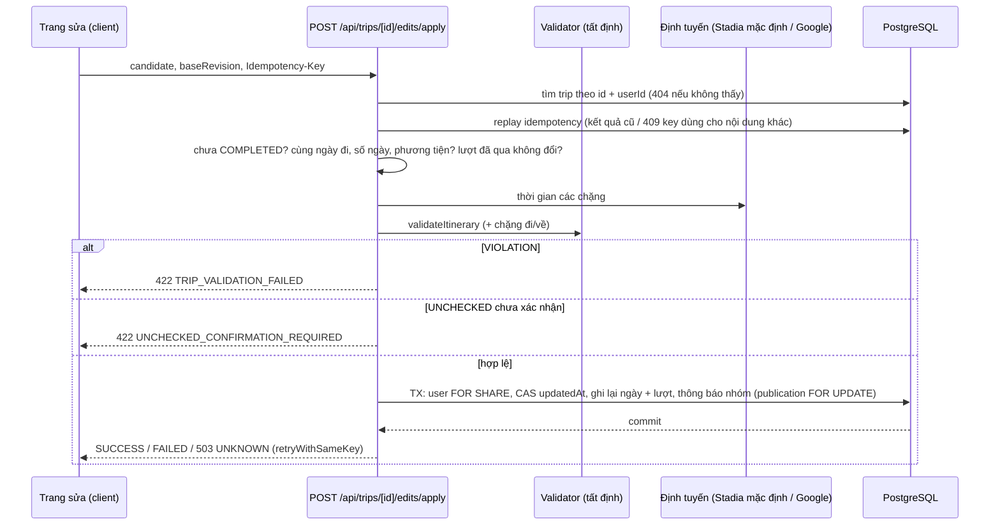

### 4.2. Bản sửa cho P07 (Hình 2.34) và P08 (Hình 2.35)

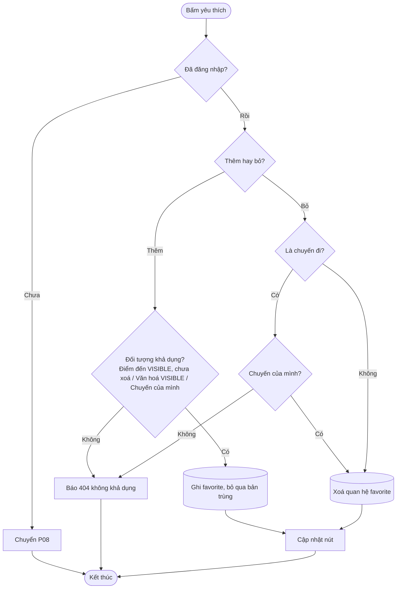

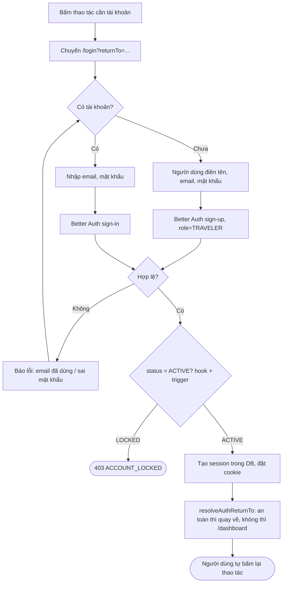

### 4.3. BFD và DFD (Hình 3.1–3.13)

| Hình | Đánh giá | Lỗi |
|---|---|---|
| 3.1 BFD | Đúng | Khớp 8 nhóm và F01–F32. Câu dẫn "giai đoạn đầu" sai. Mã nhóm F1–F8 dễ nhầm. |
| 3.4 DFD0 | Gần đúng | Bảng 3.3 chỉ ghi Google, trong khi hình có Stadia. Thiếu tác nhân SerpApi, Firecrawl, AddressKit, Petrolimex. |
| 3.5 DFD1 | **Sai** | Tráo mã 7.0/8.0; mã kho khác Bảng 3.5; kho D7 không tồn tại; DFD0 và DFD1 không cân bằng; nhãn chồng lên nhau. |
| 3.6 | Gần đúng | 1.3 thiếu đọc status; 1.4 và 1.5 thiếu Admin; thiếu luồng cookie trả về. |
| 3.7 | Gần đúng | 2.4 thiếu đọc D2/D6; 2.2 thiếu Open-Meteo và nhà cung cấp bản đồ. |
| 3.8 | **Sai** | Gộp Q&A với TripSage; khách đi qua tiến trình "TripSage"; trace ghi vào D9. |
| 3.9–3.11 | **Sai** | Có kho D7 và "ngân sách/chi phí". "Ma trận khoảng cách" sai: thực tế gọi từng chặng liền kề, tối đa 27/29 chặng. Tiến trình 6.4 "cập nhật thời tiết" không có trong module in-trip. Hình 3.10 dính thanh công cụ draw.io. |
| 3.12 | Gần đúng | Nhãn 7.5 "đối soát thành viên" sai; 7.4 thiếu sửa/gỡ bài; 6.0 vẽ như thực thể ngoài. |
| 3.13 | Sai một phần | Thiếu Vercel Blob (tệp RAG nối với 8.4, không phải Cloudinary). Nhãn "Yêu cầu chữ ký" sai. 8.6 đọc trace từ D9 sai. Thiếu Google Maps redirect và AddressKit ở 8.1. |

Không hình nào vẽ client gọi thẳng OpenAI hay API định tuyến. Điều này đúng với code: mọi lời gọi OpenAI và Routing/Places đều qua máy chủ, chỉ tile/Map JS được tải ở client.

Bản sửa DFD1 (Hình 3.5):

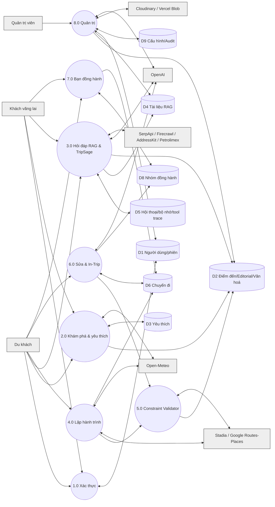

Bản sửa DFD 3.8 (hỏi đáp và trợ lý):

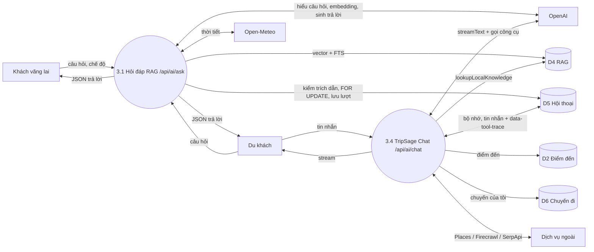

Bản sửa DFD 3.10 (Validator):

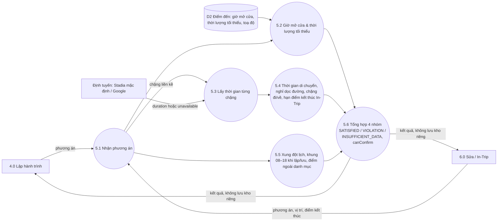

### 4.4. Kiến trúc (Hình 4.1, 4.2)

- **Hình 4.1:** đúng 4 khối. Sai số liệu "54 bảng · 55 migrations". Nhãn "chỉ gọi từ máy chủ" sai với tile/Map JS và với thao tác PUT lên Blob. Cron thực tế do GitHub Actions kích hoạt.
- **Hình 4.2:** danh sách 31 module khớp `ls apps/web/src/modules`. Bounded JSON và Error Handler có thật (`apps/web/src/server/http/read-json-body.ts:15`, `error-handler.ts:8`) nhưng là hai thành phần riêng. Thống kê DB sai.

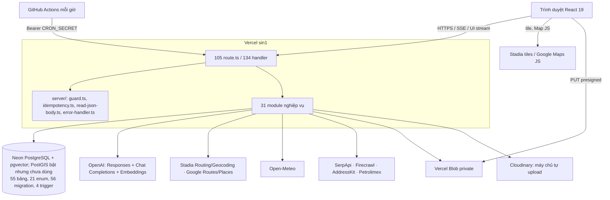

### 4.5. Thuật toán lập lịch: mô tả đúng và độ phức tạp

**Đoạn có thể chép vào báo cáo.** Trip Planner chạy tất định, không gọi AI, gồm 5 bước:

1. **Chọn điểm** (`pickPlannerStops`): tối đa `min(28, số ngày × số điểm/ngày)`, ưu tiên điểm nổi bật rồi đến điểm hợp sở thích.
2. **Sắp thứ tự sơ bộ:** dùng láng giềng gần nhất, thử mọi điểm khởi đầu. Chi phí cạnh là khoảng cách haversine, trừ 2 km nếu cùng khu vực, trừ 5 × điểm sở thích. Khi đã có điểm xuất phát xác nhận, chạy thêm 2-opt (`untangleRoundTrip`).
3. **Sắp vòng** (`orderRoundTrip`): lặp 2-opt và Or-opt cho đến khi không còn cải thiện. Chi phí là km từ bộ đệm `destination_travel_time`, hoặc haversine × hệ số uốn lượn (mặc định 2.0).
4. **Chia ngày bằng quy hoạch động có ghi nhớ:**
   - Trạng thái là (ngày d, vị trí cắt i); mỗi ngày lấy k ∈ [0, 8] điểm kế tiếp.
   - `balanceJourneyDays` (khi có chặng đi/về) so theo thứ tự từ điển: trước hết là (số lượt không xếp được × 100 + phạt về trễ hạn + phạt đêm), sau đó là Σ(phút trống)² + phạt nghỉ đêm xa thị trấn.
   - Khi không có điểm xuất phát, dùng `balancePlannerDays`.
5. **Xếp giờ:** ngày bắt đầu 08:00; với khứ hồi, từ ngày thứ 2 xuất phát 07:30. Nghỉ dọc đường theo `roadside-rest-v1`: cứ 120 phút lái ô tô (90 phút xe máy) thì nghỉ 15 phút (chế độ COMPACT 10 phút). Thời gian chặng không được nhỏ hơn quãng đường / tốc độ trần (50 / 40 km/h).

Sau đó là tối ưu mềm theo thời tiết (`optimizeScheduleForWeather`): chỉ hoán vị trong ngày hoặc đổi chỗ hai ngày, và chỉ nhận phương án khi giảm điểm phạt mà không phát sinh vi phạm mới.

Bằng chứng: `M/trip-planner/planner-order.ts:9-83`, `planner-route.ts:33-69`, `planner-day-balance.ts:17-64`, `M/trip-origin/journey-planner.ts:252-346`, `rest-policy.ts:3-24`, `planner-weather-preference.ts:189-260`.

**Độ phức tạp.** Báo cáo không nêu độ phức tạp nào (grep "O(" ra 0 kết quả). Ký hiệu: n ≤ 28 điểm, d ≤ 14 ngày, K = 8 điểm/ngày.
- Láng giềng gần nhất đa điểm khởi đầu: O(n³).
- 2-opt/Or-opt: mỗi vòng xét O(n²) cặp, nhưng mỗi cặp tính lại toàn bộ độ dài O(n), nên một vòng là **O(n³)**. Có thể cải tiến bằng cách tính chênh lệch 4 cạnh để còn O(n²).
- DP chia ngày: O(d·n·K·(K+d)), cỡ 10⁴–10⁵ phép toán.
- Thời tiết: sinh tối đa k! hoán vị mỗi ngày (k ≤ 8) rồi chỉ giữ 6.

### 4.6. Sơ đồ trạng thái (nên bổ sung)

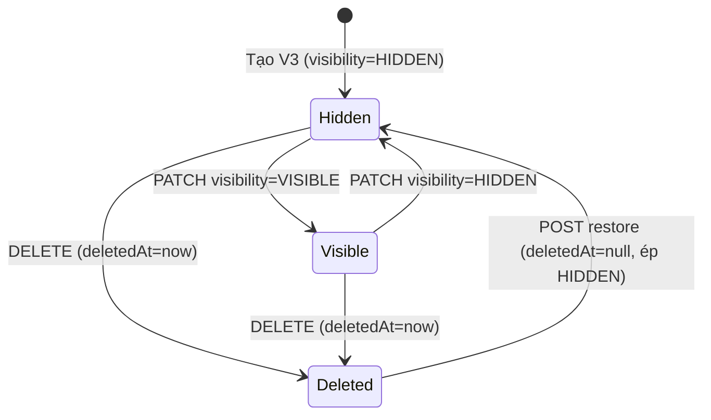

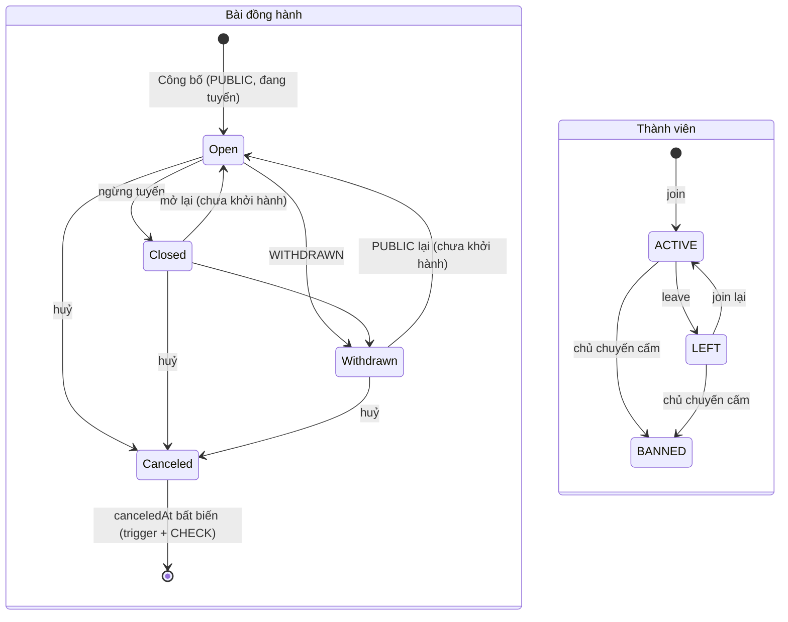

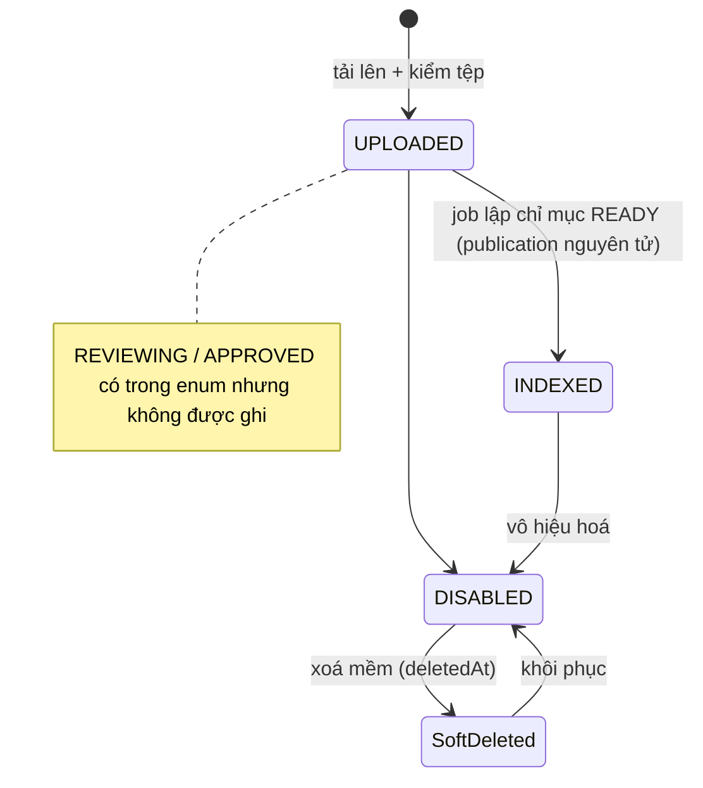

### 4.7. Sơ đồ tuần tự hỏi đáp RAG (nên bổ sung)

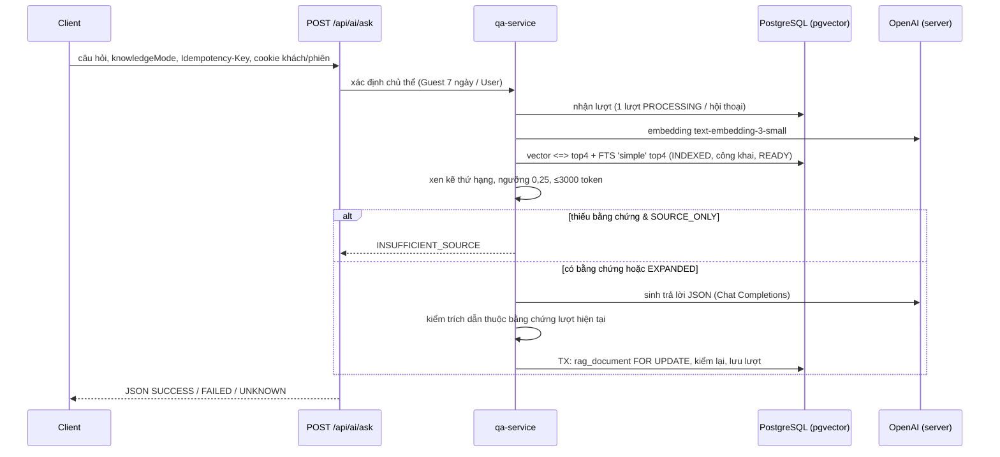

---

## 5. ERD đúng sinh từ schema.prisma

- 55 bảng nghiệp vụ và 3 bảng nối ngầm.
- Mỗi bảng chỉ ghi PK, FK và vài cột chính.
- Nếu trình hiển thị Mermaid không nhận tên bắt đầu bằng `_`, đổi thành `AreaToCultureContent`…

```mermaid
erDiagram
  user { string id PK
    string email UK
    UserRole role
    UserStatus status }
  session { string id PK
    string token UK
    string userId FK }
  account { string id PK
    string userId FK }
  verification { string id PK }
  admin_audit_event { string id PK
    string actorId FK
    string targetUserId FK }
  runtime_config { string scope PK
    string service PK
    string updatedById FK }
  runtime_config_audit { string id PK
    string actorId FK }
  traveler_memory { string id PK
    string userId FK
    vector1536 embedding }
  assistant_conversation { string id PK
    string userId FK }
  assistant_message { string id PK
    string conversationId FK
    json parts }
  assistant_v2_session_head { uuid id PK
    string userId FK }
  qa_guest_identity { char64 id PK }
  qa_conversation { string id PK
    string principalKind UK
    string principalId UK
    timestamptz deletedAt }
  qa_turn { string id PK
    string conversationId FK
    string state }
  assistant_planning_workspace { string conversationId PK
    string userId FK }
  assistant_planning_turn { string id PK
    string conversationId FK }
  destination { string id PK
    float latitude
    float longitude
    DestinationVisibility visibility
    timestamptz deletedAt
    text_array aliases }
  destination_editorial { string destinationId PK
    json draft
    json published }
  destination_travel_time { string fromDestinationId PK
    string toDestinationId PK
    TripTransport transport PK
    float durationSeconds }
  opening_day { string id PK
    string destinationId FK }
  opening_interval { string id PK
    string openingDayId FK }
  culture_content { string id PK
    CultureVisibility visibility }
  culture_destination { string cultureId PK
    string destinationId PK }
  content_area { string id PK }
  content_community { string id PK }
  _AreaToCultureContent { string A PK
    string B PK }
  _AreaToDestination { string A PK
    string B PK }
  _CommunityToCultureContent { string A PK
    string B PK }
  content_source { string id PK
    string destinationId FK
    string cultureId FK }
  content_media { string id PK
    string destinationId FK
    string cultureId FK }
  rag_domain_origin { string id PK
    string ragDocumentId FK }
  favorite { string id PK
    string userId FK
    FavoriteTargetType targetType
    string destinationId FK
    string cultureContentId FK
    string tripId FK }
  rag_document { string id PK
    RagDocumentStatus status
    timestamptz deletedAt }
  rag_content_version { string id PK
    string ragDocumentId FK }
  rag_index_generation { string id PK
    string ragDocumentId FK
    string contentVersionId FK }
  rag_chunk { string id PK
    string generationId FK }
  rag_chunk_embedding { string id PK
    string chunkId FK
    vector1536 embedding }
  rag_index_publication { string id PK
    string ragDocumentId FK
    string generationId FK }
  rag_citation_bundle { string id PK
    string generationId FK
    string contentVersionId FK }
  rag_index_job { string id PK
    string ragDocumentId FK
    RagIndexJobStatus status }
  trip { string id PK
    string userId FK
    date startDate
    TripTransport transport }
  itinerary_day { string id PK
    string tripId FK }
  itinerary_visit { string id PK
    string dayId FK
    string destinationId FK
    string externalPlaceId FK }
  external_place { string id PK }
  trip_chosen_lodging { string id PK
    string tripId FK
    string externalPlaceId FK }
  trip_nearby_suggestion { string id PK
    string tripId FK }
  trip_pinned_item { string id PK
    string tripId FK }
  trip_edit_chat_message { string id PK
    string tripId FK }
  trip_companion_publication { string id PK
    string tripId FK
    string imageMediaId FK
    CompanionVisibility visibility
    datetime canceledAt }
  trip_companion_membership { string publicationId PK
    string userId PK
    CompanionMembershipState state }
  trip_companion_message { string id PK
    string publicationId FK
    string authorId FK
    bigint sequence }
  trip_companion_read_marker { string publicationId PK
    string userId PK }
  idempotency_record { string id PK
    string scope UK
    string key UK }
  qa_abuse_bucket { string scope PK }
  qa_abuse_lease { string turnId PK }
  qa_cleanup_state { smallint id PK }
  origin_search_cache { string key PK }
  origin_search_admission { string id PK }

  user ||--o{ session : ""
  user ||--o{ account : ""
  user ||--o{ admin_audit_event : "actor"
  user ||--o{ admin_audit_event : "target"
  user ||--o{ runtime_config : "updatedBy"
  user ||--o{ runtime_config_audit : "actor"
  user ||--o{ traveler_memory : ""
  user ||--o{ assistant_conversation : ""
  assistant_conversation ||--o{ assistant_message : ""
  user ||--o{ assistant_v2_session_head : ""
  qa_conversation ||--o{ qa_turn : "FK ghép 3 cột"
  qa_conversation ||--o| assistant_planning_workspace : "PK=FK"
  user ||--o{ assistant_planning_workspace : ""
  assistant_planning_workspace ||--o{ assistant_planning_turn : ""
  destination ||--o| destination_editorial : "PK=FK"
  destination ||--o{ destination_travel_time : "from"
  destination ||--o{ destination_travel_time : "to"
  destination ||--o{ opening_day : ""
  opening_day ||--o{ opening_interval : ""
  culture_content ||--o{ culture_destination : ""
  destination ||--o{ culture_destination : ""
  content_area ||--o{ _AreaToCultureContent : "A"
  culture_content ||--o{ _AreaToCultureContent : "B"
  content_area ||--o{ _AreaToDestination : "A"
  destination ||--o{ _AreaToDestination : "B"
  content_community ||--o{ _CommunityToCultureContent : "A"
  culture_content ||--o{ _CommunityToCultureContent : "B"
  destination |o--o{ content_source : "XOR"
  culture_content |o--o{ content_source : "XOR"
  destination |o--o{ content_media : "XOR"
  culture_content |o--o{ content_media : "XOR"
  rag_document ||--o| rag_domain_origin : "UK"
  destination |o--o{ rag_domain_origin : "XOR"
  culture_content |o--o{ rag_domain_origin : "XOR"
  user ||--o{ favorite : ""
  destination |o--o{ favorite : "XOR"
  culture_content |o--o{ favorite : "XOR"
  trip |o--o{ favorite : "XOR"
  rag_document ||--o{ rag_content_version : ""
  rag_document ||--o{ rag_index_generation : ""
  rag_content_version ||--o{ rag_index_generation : ""
  rag_index_generation ||--o{ rag_chunk : ""
  rag_chunk ||--o| rag_chunk_embedding : "UK"
  rag_index_generation ||--o| rag_index_publication : "UK"
  rag_index_generation ||--o{ rag_citation_bundle : ""
  rag_content_version ||--o{ rag_citation_bundle : ""
  rag_document ||--o{ rag_index_job : ""
  user ||--o{ trip : ""
  trip ||--o{ itinerary_day : ""
  itinerary_day ||--o{ itinerary_visit : ""
  destination |o--o{ itinerary_visit : "XOR"
  external_place |o--o{ itinerary_visit : "XOR"
  trip ||--o{ trip_chosen_lodging : ""
  external_place ||--o{ trip_chosen_lodging : ""
  trip ||--o{ trip_nearby_suggestion : ""
  trip ||--o{ trip_pinned_item : ""
  trip ||--o{ trip_edit_chat_message : ""
  trip ||--o| trip_companion_publication : "UK"
  content_media |o--o{ trip_companion_publication : "ảnh"
  trip_companion_publication ||--o{ trip_companion_membership : ""
  user ||--o{ trip_companion_membership : ""
  trip_companion_publication ||--o{ trip_companion_message : ""
  user |o--o{ trip_companion_message : "null khi SYSTEM"
  trip_companion_publication ||--o{ trip_companion_read_marker : ""
  user ||--o{ trip_companion_read_marker : ""
```

**Bảng không có FK** (8 bảng): verification, qa_guest_identity, idempotency_record, qa_abuse_bucket, qa_abuse_lease, qa_cleanup_state, origin_search_cache, origin_search_admission.

**Enum thật** (21 enum):
- UserRole: TRAVELER / ADMIN
- UserStatus: ACTIVE / LOCKED
- AdminAuditEventType: 4 giá trị
- ContentRightsStatus, ContentVerificationStatus
- CultureVisibility, DestinationVisibility: HIDDEN / VISIBLE
- Weekday, OpeningStatus
- FavoriteTargetType: DESTINATION / CULTURE_CONTENT / TRIP
- RagDocumentStatus: UPLOADED / REVIEWING / APPROVED / INDEXED / DISABLED
- RagDocumentFileType: PDF / DOCX / TXT
- RagIndexJobStatus (8 giá trị), RagIndexJobPhase (10 giá trị), RagIndexGenerationState: BUILDING / READY
- TravelerMemoryKind
- TripTransport: MOTORCYCLE / CAR
- CompanionMembershipState: ACTIVE / LEFT / BANNED
- CompanionVisibility: PUBLIC / WITHDRAWN
- CompanionMessageKind: USER / SYSTEM
- ExternalPlaceProvider: GOOGLE_PLACES

---

## 6. Số liệu cần kiểm lại

| Số liệu | Báo cáo | Đếm được | Lệnh hoặc nguồn |
|---|---|---|---|
| Bảng | 54 | **55** model (+3 bảng nối ngầm = 58) | `grep -h "^model " packages/db/prisma/schema/*.prisma \| wc -l` |
| Enum | 21 | 21 | `grep -h "^enum " … \| wc -l` |
| Migration | 54 / 55 | **56** | `ls packages/db/prisma/migrations \| grep -v toml \| wc -l` |
| Trigger | 4 | 4, đúng tên | `grep -rhoi "CREATE TRIGGER [a-z_\"]*" packages/db/prisma/migrations` |
| Tệp schema | 23 | 23 | `ls schema` |
| FK | 57 + 6 | 59 + 6 = 65 | grep `fields: [` |
| Bảng có xoá mềm | — | 3 (destination, qa_conversation, rag_document) | grep `deletedAt` |
| Cột vector | — | 2, đều vector(1536); không có HNSW/IVFFlat/GIN | grep |
| Cột không gian PostGIS | "có" | **0** | `grep -rniE "geography\|geometry\(" packages/db/prisma` cho kết quả rỗng |
| Tệp route | 105 | 105 | `find apps/web/src/app/api -name route.ts \| wc -l` |
| Handler | 132 / 139 | **134** (132 + 2 catch-all) | `grep -rhoE "^export (async )?(function\|const) (GET\|POST\|PUT\|PATCH\|DELETE)\b" … \| wc -l` cho 132 |
| Trang | 36 (22 + 14) | 36 (22 + 14); 31 trang hoạt động trên production | `find apps/web/src/app -name page.tsx` |
| Module | 31 | 31 | `ls apps/web/src/modules` |
| Tệp test | 528 / >540 | 559 = 528 Vitest + 31 node:test; 0 tệp spec; 0 Playwright | `git ls-files \| grep -E "\.(test\|spec)\.(ts\|tsx)$"` |
| Tệp production | 1.060 | 942–944 (.ts/.tsx không phải test) | `git ls-files … \| grep -vE test \| grep -v generated` |
| Component | >100 / 141 | 17 (@KLTN/ui) + 125 (apps/web/src/components) | find |
| Công cụ TripSage | 17 | tối đa 23 (15 + 3 + 5) | `tripsage-chat-tools.ts:2442` |
| Công cụ Trip Edit | 6 | 6 | `trip-assistant-agent.ts:558-631` |
| Kỹ năng / action Agent V2 | 4 / 11 | 4 / 11 | `skill-registry.ts`, `assistant-actions.ts` |
| Chunk | 1600 / 200 | khớp | `chunk-document.ts:9` |
| topK / token | 4 / 3000 | Q&A 4 / 3000 / 0,25; TripSage 4 / 2000 / 0,38 | `qa-runtime.ts:28`, `tripsage-chat-runtime.ts:66` |
| Model | gpt-6-luna, gpt-6.1-terra, gpt-6-sol, gpt-6.1-sol | khớp; mặc định `gpt-6.1-terra` | `M/runtime-config/openai-model-catalog.ts:8-11` |
| Bảng ghi khi lưu chuyến | 7 | 7 bảng nghiệp vụ + idempotency_record | `trip-save-service.ts:243,276-296` |
| Timeout định tuyến | 40 giây | 40 giây (lập lịch, sửa); 10 giây (lưu, In-Trip); 8 giây (geocoding) | xem mục 2 #26 |
| Nghỉ dọc đường | 120 / 90 → 15 (10) phút | khớp | `rest-policy.ts:15-16,24` |
| Test case Excel | 535 / 535 PASS | 535 / **530 PASS / 5 chưa chạy** | đếm `D:\KLTN\Test.xlsx` theo cột "Kết quả QA" |
| Vùng Vercel | sin1 | sin1 | `vercel.json:3` |
| Điểm đến / tài liệu RAG | 30–50 / 20–50 | không kiểm được từ repo; docs ghi 22 điểm VISIBLE và khoảng 5 tài liệu | `docs/ai-progress.md:6273`; `rag-sync-evidence/final-summary.json` |
| Lark: 49 US / 358 tác vụ / 339 điểm | — | KHÔNG TÌM THẤY trong repo | grep lark/bitable |
| Khảo sát 72 phiếu | — | KHÔNG TÌM THẤY trong repo | — |

---

## 7. Câu hội đồng có thể hỏi và gợi ý trả lời

1. **"Bảng 5.4 ghi 100% PASS, nhưng Kết luận lại nói còn 5 test case chưa chạy?"**
   Thừa nhận lỗi tổng hợp. Số thật là 535 test case: 530 PASS, 5 chưa chạy (US-38). Log Vitest gần nhất: 486 passed, 40 skipped, 1 failed trên 527 tệp (`docs/ai-progress.md:6514`).
2. **"Kết quả RQ1/RQ2 đâu?"**
   Chưa có thí nghiệm đối chứng. Có bộ kiểm hồi quy grounding (`M/ai/qa-evaluation.ts`) và 9 ca chạy thật. Nêu đây là hạn chế và phương án đánh giá đã thiết kế.
3. **"Hệ thống dùng Google hay Stadia?"**
   Mặc định Stadia (`maps-provider.ts:4`), đổi sang Google bằng cấu hình runtime MAPS. Khoá định tuyến chỉ nằm ở máy chủ. Khi định tuyến lỗi, chặng nhận `ROUTE_UNAVAILABLE` thành INSUFFICIENT_DATA, và `canConfirm` = false.
4. **"Validator có kiểm ngân sách không?"**
   Không. Validator có 4 nhóm (`trip-validation.ts:21`). Ngân sách chỉ là gợi ý tham khảo của TripSage (`tripsage-budget.ts`).
5. **"Admin có xem được chat của người dùng không?"**
   Có, qua AI Tool Trace (`tripsage-tool-trace.ts:52-55`), để giám sát vận hành; dữ liệu công cụ bộ nhớ được che. Các API chuyến đi, yêu thích, bộ nhớ đều lọc theo `userId`.
6. **"PostGIS dùng ở đâu?"**
   Hiện chưa dùng; mới bật extension. Toạ độ lưu bằng Float có CHECK miền giá trị. Nên trả lời thẳng.
7. **"Độ phức tạp 2-opt?"**
   Mỗi vòng O(n³) do tính lại toàn bộ độ dài; với n ≤ 28 thì vẫn nhỏ. DP chỉ tối ưu việc cắt ngày trên một thứ tự đã cố định, nên kết quả tổng thể không tối ưu toàn cục.
8. **"Hybrid retrieval có phải RRF không?"**
   Không. Đây là xen kẽ thứ hạng, vì điểm cosine và `ts_rank_cd` khác thang đo (`qa-retrieval.ts:259-270`). Không có HNSW, cũng không có GIN.
9. **"Lập chỉ mục tài liệu lớn trên serverless thế nào?"**
   Job chạy trong request (khoảng 240 giây), có lease 120 giây và checkpoint các batch embedding; khi gián đoạn thì RESUME/RETRY.
10. **"Chống vượt số chỗ khi nhiều người cùng tham gia?"**
    Khoá theo thứ tự cố định: user FOR SHARE, rồi trip FOR UPDATE, rồi publication FOR UPDATE; sau đó mới đếm ACTIVE (`companion-group-service.ts:44-55,99`).
11. **"Khoá tài khoản có hiệu lực ngay không?"**
    Có ba lớp: guard đọc status từ DB ở mỗi request; lệnh khoá xoá mọi session; hook kèm trigger `session_requires_active_user` chặn tạo phiên mới.
12. **"Idempotency xử lý hai request cùng key đồng thời thế nào?"**
    Unique `(scope, key)`; bản ghi key nằm cùng `$transaction` với dữ liệu nghiệp vụ; request thua đọc lại bản đã commit; cùng key nhưng khác hash thì trả 409 (`idempotency.ts:134-143,257-285`).
13. **"Vì sao không có use case hay sequence diagram?"**
    Nhóm chọn phương pháp hướng cấu trúc (BFD, DFD, swimlane). Có thể đưa các bản sequence/state ở mục 4 của tài liệu này vào phụ lục.

---

## 8. Những gì chưa kiểm được và lý do

- **Production:** không truy cập `https://kltn-rho.vercel.app/` và không truy vấn Neon, theo quy tắc chỉ đọc. Vì vậy chưa biết production đang dùng Stadia hay Google, các cờ và ngưỡng đang đặt (RuntimeConfig có thể ghi đè mặc định), số điểm đến, tài liệu RAG và bài văn hoá thực tế, cũng như DDL thật trên Neon.
- **Typecheck, build, test:** chưa chạy vì có thể ghi file cache hoặc cần DB/mạng. Kết luận về test dựa trên đếm tệp và log trong `docs/ai-progress.md`.
- **Sơ đồ:** đọc từ ảnh trích ra khỏi .docx. Một số hình độ phân giải thấp (2.26, 2.30, 2.31, 3.5), có thể đọc sót nhãn nhỏ. Việc ghép chú thích với ảnh của Hình 4.5, 4.6, 4.31 dựa trên thứ tự trích xuất; nên mở .docx gốc để xác nhận.
- **Chương 2.1** (khảo sát 72 phiếu, Hình 2.1–2.23) và **chương 1.3** (đối thủ): không có trong repo nên không đối chiếu với code.
- **Lark và Excel:** số liệu Lark (49 US, 358 tác vụ, 339 điểm) không có trong repo. `Test.xlsx` nằm ngoài repo, đã đọc được nhưng không nằm trong git.
- **Kiểm chưa trọn:** chưa đọc hết prompt và bước kiểm câu của Q&A (`qa-assessment.ts`, `qa-synthesis-verification.ts`). Chưa kiểm luồng lưu chuyến từ chat (`tripsage-chat-save.ts`). Số endpoint ghi có Idempotency (khoảng 50/76) là ước lượng từ rà tay, không có lệnh đếm tự động. Số CHECK (khoảng 61) đếm bằng grep, chưa phân tích cú pháp SQL.
- **Điểm chỉ nằm trong code, báo cáo không nhắc** (để tham khảo, không phải lỗi của báo cáo):
  - Sau khi huỷ nhóm, API quản lý vẫn cho sửa tiêu đề.
  - Thông báo đổi lịch vẫn được chèn vào nhóm đã huỷ.
  - Khoá MOBILITY không nhất quán giữa lúc đề xuất và lúc lưu (`planner-validator.ts:53` so với `journey-save-validation.ts:42-49`).
  - Route `trips/[id]/edits/apply` đọc `GOOGLE_PLACES_API_KEY`, biến này không có trong `.env.schema`.
  - Upload ảnh tối đa 10 MB đi qua Vercel Function, có thể vượt giới hạn kích thước body request.
