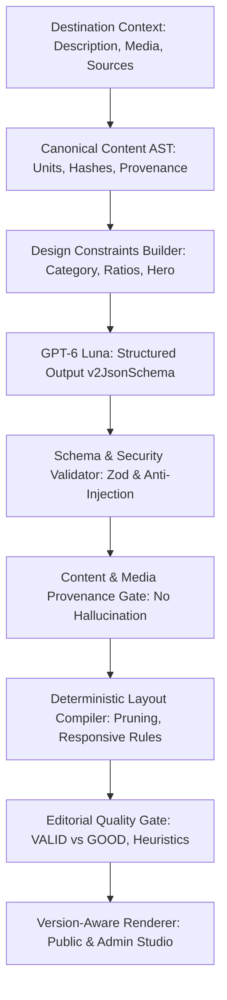

# Destination E-Magazine V4.0: AI Generative Layout Engine Architecture

## 1. Executive Summary & Design Vision

E-Magazine V4.0 marks an architectural transition from fixed template composition (V3.6) to an **AI Generative Layout Engine**. Instead of selecting from 12 predefined variants, GPT-6 Luna designs custom editorial layouts directly from destination canonical data, imagery, and narrative structures.

The core design principle is **declarative safety**: AI synthesizes layout structures using a bounded domain-specific language (**Editorial Layout DSL v2**), completely isolated from execution capabilities (no executable code, no HTML tags, no arbitrary CSS selectors, bounded recursion $\le 3$, maximum node count $\le 50$).

---

## 2. Editorial Layout DSL v2 Specification

### 2.1. Invariants & Security Guardrails

The DSL v2 schema is strictly enforced via Zod and JSON Schema:
- **No Arbitrary Executable Code**: JavaScript, event handlers, scripts, and eval expressions are prohibited.
- **No Arbitrary HTML / DOM Injection**: All content is rendered through verified React component primitives.
- **No Arbitrary External Assets**: AI cannot generate or reference image URLs outside the approved Destination Media Library.
- **Strict Tree Bounds**: Maximum node count $\le 50$, maximum nesting depth $\le 3$, maximum grid columns $\le 4$, maximum sections $\le 25$.
- **Design Tokens**: Typography (`LITERARY`, `MODERN`, `HUMANIST`, `EDITORIAL_SERIF`, `GEOMETRIC_SANS`), Palettes (`FOREST`, `SLATE`, `EARTH`, `MONOCHROME`, `TERRACOTTA`, `INDIGO`), Rhythms (`IMMERSIVE`, `COMPACT`, `RELAXED`, `STACCATO`), Container Widths (`NARROW`, `STANDARD`, `WIDE`, `FULL`).

### 2.2. Layout Primitives Catalog

| Category | Primitives | Purpose & Capabilities |
| :--- | :--- | :--- |
| **STRUCTURE** | `PAGE`, `SECTION`, `GRID`, `STACK`, `COLUMNS`, `CONTAINER` | Responsive topology, column ratios, gaps, and semantic section grouping |
| **CONTENT** | `HEADING`, `PARAGRAPH`, `LEAD`, `QUOTE`, `FACTS`, `TIMELINE` | Structured reading units anchored to source provenance |
| **MEDIA** | `IMAGE`, `PANORAMA`, `IMAGE_TEXT`, `GALLERY`, `IMAGE_MOSAIC` | Proportional image presentations, focal points, crops, and multi-image arrangements |
| **SPECIAL** | `HERO`, `MAP`, `SOURCES`, `VISIT_INFORMATION` | Standardized functional modules (hero masthead, reference coordinates, vetted citations) |

---

## 3. Canonical Content AST & Provenance Architecture

To prevent AI hallucination of facts, dates, characters, or quotes:
1. **Content Normalization & Segmentation**: Destination description is segmented into structured units (`INTRO`, `CHAPTER_HEADING`, `PARAGRAPH`, `HISTORICAL_EVENT`, `GEOGRAPHICAL_FACT`, `CULTURAL_INFO`, `VISITOR_GUIDANCE`, `CITATION`).
2. **Stable Deterministic Hashes**: Each AST unit receives a SHA-256 fingerprint anchored to normalized Vietnamese text.
3. **Extractive Anchoring**: Section headings and quote texts must match canonical source excerpts or exact provenance records.
4. **Content Preservation Verification**: The Quality Gate requires complete canonical description preservation ($P = 100\%$), including chapter headings and visitor guidance.

---

## 4. Deterministic Compiler Pipeline

The layout compiler (`editorial-compiler.ts`) transforms DSL v2 JSON into an executable display tree:
1. **Reference Resolution**: Resolves `contentRef` pointers to AST units.
2. **Media Eligibility Filtering**: Filters media against destination ownership, checking Cloudinary format and `websiteRights`.
3. **Empty Node Pruning**: Automatically suppresses utility sections lacking data without mutating stored draft data.
4. **Responsive Reflow**: Derives responsive breakpoints:
   - **Mobile (390px)**: Columns collapse to single-column stack, full-width fluid media, readable font scales.
   - **Tablet (768px)**: 2-column grids, balanced split cards.
   - **Desktop (1440px)**: Multi-column mosaics, panorama hero layouts, max-width standard/wide containers.

---

## 5. Editorial Quality Gate: VALID vs GOOD Layout

A layout passing schema validation may still be aesthetically unbalanced. The Quality Gate (`editorial-quality-gate.ts`) enforces heuristic standards:
- **Hero Integrity**: Exactly one active Hero section at the root.
- **Media Deduplication**: Zero duplicated media IDs across the document.
- **Section Completeness**: Detection and penalization of empty structural nodes.
- **Heading Hygiene**: Deduplication of headings and enforcement of concise lengths ($\le 70$ characters, $\le 10$ words).
- **Prose Continuity**: Verification that canonical story paragraphs are retained and readable.

---

## 6. Dual-Version Contract & Backward Compatibility

- **Discriminated Union**: `editorialLayoutSchema = z.discriminatedUnion("schemaVersion", [editorialLayoutV1Schema, editorialLayoutV2Schema])`.
- **Zero Schema Migration**: Stored in existing PostgreSQL `destination_editorials` JSONB columns (`draft`, `published`, `previousPublished`, `revisions`).
- **Isolation of V1 Data**: Existing published V1 articles render via the V1 layout engine without forced migration.
- **Safe Rollback**: Reverting a V2 publication restores previous published states (whether V1 or V2) with full fidelity.
