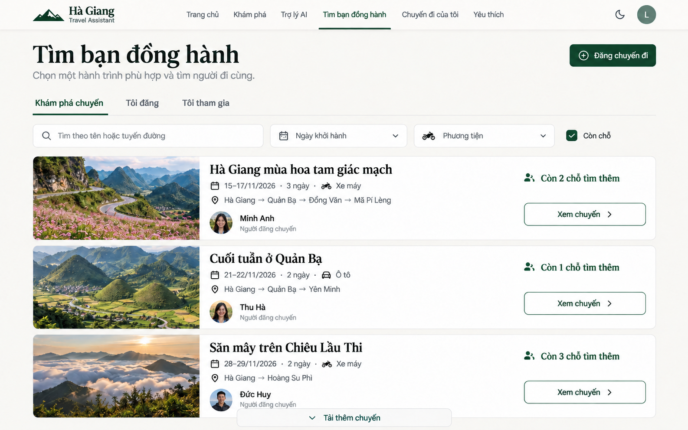
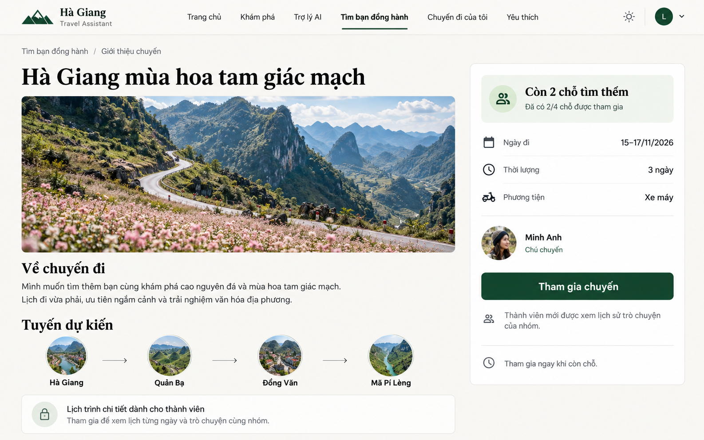
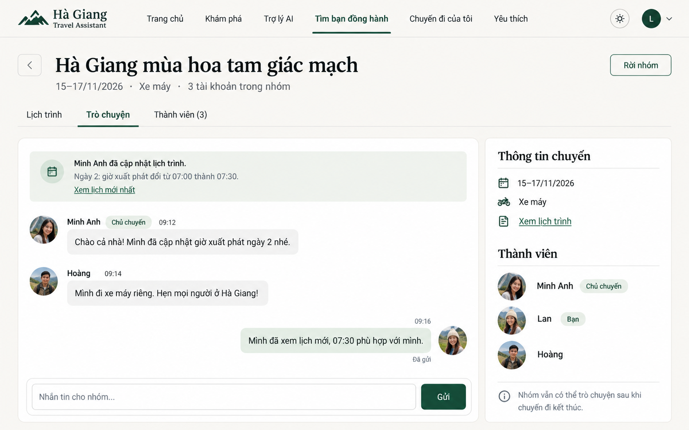

# Tìm bạn đồng hành — ảnh mockup desktop

Ngày: 2026-10-28. Tạo bằng built-in **image_gen**, theo [kế hoạch](../../implementation/trip-companions-design.md) và [phân tích UI/UX](../trip-companions-ui-ux-analysis.md).

Ba ảnh là minh họa để xem bố cục, không phải UI đã triển khai hoặc bản thiết kế đã kiểm chứng bằng browser/Figma. Tên, avatar, hội thoại, ngày đi và ảnh phong cảnh là dữ liệu/ảnh minh họa. Không xác nhận độ chính xác của cảnh thật, màu pixel hoặc mọi chi tiết chữ bằng ảnh sinh.

## Tìm bạn đồng hành

## Giới thiệu chuyến

## Nhóm trò chuyện

[Prompt set và chỉnh sửa đã dùng](prompts.md). Ảnh khám phá cuối đã bỏ các dòng đếm người mơ hồ, giữ nhãn số chỗ tìm thêm. Không sửa code/schema, không thêm dependency hoặc triển khai ứng dụng trong lần tạo ảnh này.
