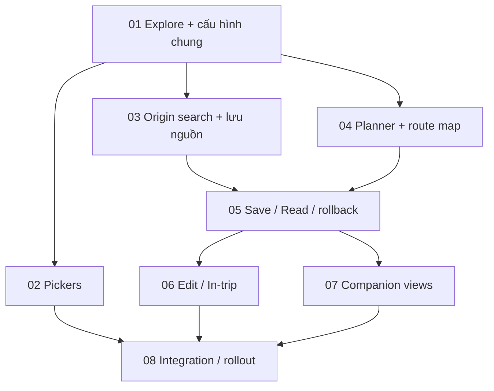

# Google Maps/Stadia — bản chia ticket để duyệt

Ngày: 2026-11-18. Trạng thái: IN PROGRESS — chủ dự án tiếp tục bằng yêu cầu implement toàn bộ sau bản chia tám ticket; đã đưa ticket vào local issues. Code local/automated verification hoàn tất; live acceptance còn mở. Xem [verification receipt](google-maps-provider-switch-verification.md).

Nguồn: [spec đã chốt](../specs/google-maps-provider-switch-spec.md). Phạm vi Q1–Q7 và seam kiểm thử đã được duyệt. Yêu cầu implement kế tiếp được hiểu là cho phép dùng nguyên bộ chia/phụ thuộc đã trình bày, không yêu cầu đổi hay tách/gộp. [Story](../stories/MAPS-PROVIDER-SWITCH.md) và [runbook](google-maps-provider-switch-runbook.md) phân biệt code/test/live.

## Cách chia và nơi lưu

- Mỗi ticket là một lát cắt hành vi có thể demo/kiểm chứng, gồm code UI/API/service/schema nếu cần và test ở seam hiện có. Không chia riêng ticket BE/FE/test.
- Prefactor tối thiểu cho provider/map contract nằm đầu ticket 01 rồi chứng minh bằng Explore; không tạo ticket refactor ngang chưa có hành vi dùng được. Ticket sau mở rộng cùng contract; không cần cơ chế wide-refactor expand–contract riêng trừ khi phát hiện blast radius mới khi triển khai.
- Trong giai đoạn làm từng ticket, phiên bản trung gian có thể còn consumer cũ. Không coi đó là đã đáp ứng cờ toàn website. Chỉ nghiệm thu/kích hoạt toàn phạm vi sau ticket 08; cả hai provider và hành vi cũ phải tiếp tục kiểm thử được trong quá trình chuyển.
- Dự án có tiền lệ dùng file local cho tracker. Đã chuyển một file mỗi ticket sang `.scratch/google-maps-provider-switch/issues/` và ghi IN PROGRESS theo yêu cầu bắt đầu triển khai; không đăng issue dịch vụ ngoài hoặc suy đoán tracker từ Git remote.
- Nếu muốn xuất sang tracker ngoài thay vì local, chạy `/setup-matt-pocock-skills` để cung cấp đích/triage trước khi đăng.
- Bản tạo ticket ban đầu chỉ lập kế hoạch; yêu cầu implement sau đó đã cho phép code và commit nhánh hiện tại. Không merge/push/deploy production hoặc thay shared DB.

## Tám ticket đề xuất

1. **GM-01 — Explore dùng Google/Stadia qua cấu hình chung**
   **Blocked by:** None (can start immediately).
   **Bàn giao:** Guest mở Explore và xem đúng các điểm công khai trên Google Maps khi bật cờ hoặc Stadia khi tắt; lựa chọn browser/server đến từ một cấu hình chung.
   [Ticket 01](../../.scratch/google-maps-provider-switch/issues/01-explore-map-provider-switch.md).

2. **GM-02 — Chọn tọa độ Admin và nơi xuất phát trên cả hai bản đồ**
   **Blocked by:** 01 — Explore dùng Google/Stadia qua cấu hình chung.
   **Bàn giao:** Admin chọn tọa độ điểm đến và Traveler đặt pin nơi xuất phát trên bản đồ đang bật, tiếp tục xác nhận/lưu qua các luồng hiện có.
   [Ticket 02](../../.scratch/google-maps-provider-switch/issues/02-coordinate-pickers.md).

3. **GM-03 — Tìm, xác nhận và lưu nơi xuất phát bằng provider đang chọn**
   **Blocked by:** 01 — Explore dùng Google/Stadia qua cấu hình chung.
   **Bàn giao:** Traveler tìm một nơi xuất phát trong coverage Việt Nam, chọn kết quả, xác nhận và đọc lại nơi xuất phát với nguồn dữ liệu đúng; tắt cờ vẫn đọc được dữ liệu đã lưu.
   [Ticket 03](../../.scratch/google-maps-provider-switch/issues/03-origin-search-provenance.md).

4. **GM-04 — Đề xuất hành trình với tuyến và bản đồ đúng provider**
   **Blocked by:** 01 — Explore dùng Google/Stadia qua cấu hình chung.
   **Bàn giao:** Traveler tạo itinerary proposal từ Planner hoặc hội thoại, xem tuyến từng ngày/toàn chuyến và kết quả Validator dựa trên routing của provider đang bật.
   [Ticket 04](../../.scratch/google-maps-provider-switch/issues/04-planner-routing-map.md).

5. **GM-05 — Lưu, mở lại chuyến đi và giữ dữ liệu khi đổi cờ**
   **Blocked by:** 03 — Tìm, xác nhận và lưu nơi xuất phát bằng provider đang chọn; 04 — Đề xuất hành trình với tuyến và bản đồ đúng provider.
   **Bàn giao:** Trip owner xác nhận Save, hệ thống kiểm tra tuyến mới bằng provider hiện hành, lưu đúng nguồn và mở lại lịch trình; đổi cờ không ghi đè chuyến đi.
   [Ticket 05](../../.scratch/google-maps-provider-switch/issues/05-save-read-rollback.md).

6. **GM-06 — Chỉnh lịch và hỗ trợ khi đang đi qua provider hiện hành**
   **Blocked by:** 05 — Lưu, mở lại chuyến đi và giữ dữ liệu khi đổi cờ.
   **Bàn giao:** Trip owner chỉnh lịch thường/AI, đổi chặng đi/về hoặc dùng in-trip preview; các thao tác cần tuyến mới dùng provider đang bật và tiếp tục xác nhận/lưu theo quy tắc hiện có.
   [Ticket 06](../../.scratch/google-maps-provider-switch/issues/06-edit-in-trip.md).

7. **GM-07 — Hiển thị tuyến đồng hành đúng nguồn và đúng quyền**
   **Blocked by:** 05 — Lưu, mở lại chuyến đi và giữ dữ liệu khi đổi cờ.
   **Bàn giao:** Guest xem giới thiệu công khai và thành viên xem lịch nhóm với bản đồ đang chọn, nhận dữ liệu tuyến đúng nguồn và đúng mức riêng tư.
   [Ticket 07](../../.scratch/google-maps-provider-switch/issues/07-companion-projections.md).

8. **GM-08 — Kiểm chứng chuyển Google toàn phạm vi và quay lại Stadia**
   **Blocked by:** 02 — Chọn tọa độ Admin và nơi xuất phát trên cả hai bản đồ; 06 — Chỉnh lịch và hỗ trợ khi đang đi qua provider hiện hành; 07 — Hiển thị tuyến đồng hành đúng nguồn và đúng quyền.
   **Bàn giao:** Người vận hành có một cấu hình thống nhất, hướng dẫn triển khai và bằng chứng kiểm thử để bật Google hoặc quay lại Stadia mà không đổi nghiệp vụ hay dữ liệu chuyến đi.
   [Ticket 08](../../.scratch/google-maps-provider-switch/issues/08-integration-rollout.md).

## Đồ thị phụ thuộc

01 là frontier ban đầu. Sau 01, các ticket 02/03/04 không chặn nhau. 05 cần cả origin provenance và planner evidence; 06/07 dùng Save/Read đã tương thích hai nguồn và có thể làm độc lập với nhau. 08 chỉ ghi blocking edges trực tiếp; 01/03/04/05 đã được bao phủ bắc cầu.

## Ranh giới hoàn tất

- Mỗi ticket giao cả behavior và kiểm tra liên quan, không đánh dấu IMPLEMENTED chỉ vì BE hoặc FE riêng lẻ xong.
- Mỗi ticket ghi evidence code/test/browser/live riêng. Các tiêu chí live chưa có key hoặc billing vẫn mở, không giả lập thành đã nghiệm thu.
- Migration enum origin nếu cần thuộc 03, chỉ cộng thêm và tương thích dữ liệu cũ. Các test PostgreSQL chạy trên DB thử nghiệm; không áp shared DB trong task chia ticket.
- Không thay điều kiện Validator/Save/unchecked/ownership hoặc bật edit external-place đang bị chặn. Không viết lại trip cũ; không xóa Stadia khi hoàn tất.
- Home/Detail iframe và Google Places ngoài danh mục đã có giữ nguyên như spec. Tắt cờ không có nghĩa website không được phát bất kỳ Google request nào.

## Lịch sử review bản chia

Bản chia tám ticket, độ nhỏ/phụ thuộc và nơi xuất local đã được trình bày trước khi chủ dự án yêu cầu thực hiện code toàn bộ. Không có thay đổi phạm vi hoặc blocking edge được yêu cầu. Đây không phải xác nhận live acceptance hay hoàn tất các checkbox trong từng issue.
