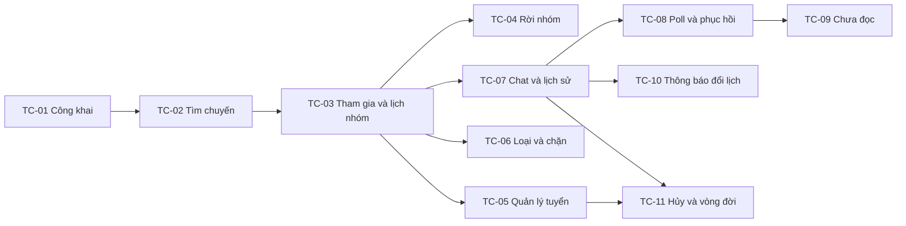

# Tìm bạn đồng hành — chia ticket và prompt thực thi

Ngày: 2026-10-28. Trạng thái: **APPROVED BREAKDOWN / PUBLISHED LOCALLY; TC-01 BE + FE IMPLEMENTED LOCALLY** — người dùng duyệt “Duyệt nguyên bộ 11 ticket và các phụ thuộc”. TC-01 có bằng chứng tích hợp và migration Development; TC-02–11 chưa triển khai. Nghiệp vụ Q1–Q17 và dependency giữ nguyên; nghiệm thu đầy đủ của chủ dự án còn riêng. [Hiện trạng và các thiếu sót UI](trip-companions-implementation-status.md), [contract/evidence](trip-companions-delivery-contract.md#tc-01--contract-thực-2026-10-28).

## Nguồn và nơi lưu

- [Kế hoạch đã duyệt](trip-companions-design.md), [product extension](../product/product-spec.md#planned-travel-companions-extension--approved-2026-10-28), [ADR-23](../decisions.md#adr-23--travel-companions-preserve-single-trip-ownership-2026-10-28) và glossary.
- [Phân tích UI/UX](../design/trip-companions-ui-ux-analysis.md), [ba ảnh mockup](../design/trip-companions-mockups/README.md). Người dùng đã trả lời “OK rồi” với ảnh rồi yêu cầu chia ticket. Ảnh là tham chiếu bố cục đã chấp nhận, không chứng minh browser/Figma acceptance hoặc xác lập mọi pixel/chữ sinh trong ảnh.
- Quy ước local tracker đã được chọn trong các đợt trước của dự án; tham khảo ghi nhận tại [Destination Assistant plan](destination-assistant-popup-plan.md). Không tạo issue trên dịch vụ ngoài hoặc chat mới.
- Ticket chính thức: một file mỗi ticket tại `.scratch/trip-companions/issues/`, nhãn ban đầu `ready-for-agent`. Đã chuyển nguyên bộ 11 file từ drafts/ sau xác nhận của người dùng; scope, acceptance criteria và blocking edges giữ nguyên. Trạng thái thực thi hiện hành ghi riêng trong issue và delivery contract; hoàn tất BE không mở khóa ticket sau khi FE/tích hợp còn OPEN.

## 11 ticket đã duyệt

1. **TC-01 — Công khai Trip đã lưu và xem giới thiệu**
   **Blocked by:** Không có.
   **Bàn giao:** Chủ chuyến mở form từ Trip đã lưu, xem trước phần sẽ công khai và đăng thành công; người ngoài mở được giới thiệu đúng phạm vi cho phép.
   [Ticket](../../.scratch/trip-companions/issues/01-publish-public-introduction.md).

2. **TC-02 — Khám phá và lọc chuyến công khai**
   **Blocked by:** TC-01.
   **Bàn giao:** Người dùng vào kênh tìm bạn, tìm/lọc chuyến sắp đi theo ngày, phương tiện và còn chỗ, rồi mở trang giới thiệu.
   [Ticket](../../.scratch/trip-companions/issues/02-discover-filter-trips.md).

3. **TC-03 — Tham gia ngay và mở lịch của nhóm**
   **Blocked by:** TC-02.
   **Bàn giao:** Tài khoản đăng nhập bấm tham gia khi còn chỗ, nhận membership đã xác nhận, vào nhóm xem lịch mới nhất và tìm lại chuyến trong Tôi tham gia.
   [Ticket](../../.scratch/trip-companions/issues/03-instant-join-member-itinerary.md).

4. **TC-04 — Tự rời nhóm và trả chỗ**
   **Blocked by:** TC-03.
   **Bàn giao:** Thành viên tự rời nhóm, mất quyền nhóm và trả chỗ; có thể tham gia lại khi vẫn đủ điều kiện.
   [Ticket](../../.scratch/trip-companions/issues/04-leave-return-place.md).

5. **TC-05 — Quản lý số chỗ, đóng tuyển và gỡ công khai**
   **Blocked by:** TC-03.
   **Bàn giao:** Host chỉnh phần giới thiệu/số chỗ, đóng hoặc mở lại tuyển người, gỡ hoặc công khai lại bài mà vẫn giữ nhóm.
   [Ticket](../../.scratch/trip-companions/issues/05-manage-recruitment-capacity.md).

6. **TC-06 — Chủ chuyến loại và chặn thành viên**
   **Blocked by:** TC-03.
   **Bàn giao:** Host xem danh sách thành viên, loại một người và chặn tài khoản đó tham gia lại; nhóm còn lại tiếp tục hoạt động.
   [Ticket](../../.scratch/trip-companions/issues/06-remove-ban-member.md).

7. **TC-07 — Gửi tin văn bản/link và đọc lịch sử nhóm**
   **Blocked by:** TC-03.
   **Bàn giao:** Host và thành viên đang tham gia nhắn văn bản/link trong một phòng chat của chuyến; thành viên mới đọc được lịch sử cũ.
   [Ticket](../../.scratch/trip-companions/issues/07-group-text-chat-history.md).

8. **TC-08 — Cập nhật tin mới và phục hồi mất kết nối**
   **Blocked by:** TC-07.
   **Bàn giao:** Người đang mở nhóm nhận tin mới trong vài giây, quay lại tab thấy phần mới và đối soát được tin chưa xác nhận mà không mất/trùng tin.
   [Ticket](../../.scratch/trip-companions/issues/08-polling-reconnect-recovery.md).

9. **TC-09 — Dấu chưa đọc và quay lại nhóm có tin mới**
   **Blocked by:** TC-08.
   **Bàn giao:** Tài khoản nhận biết nhóm nào có tin chưa đọc trong Tôi tham gia, mở đúng cuộc trò chuyện và cập nhật dấu đã đọc của riêng mình.
   [Ticket](../../.scratch/trip-companions/issues/09-unread-return-to-group.md).

10. **TC-10 — Đổi lịch đã lưu và thông báo nhất quán trong nhóm**
   **Blocked by:** TC-07.
   **Bàn giao:** Host sửa/lưu lịch bằng luồng Trip hiện có; nhóm xem lịch mới nhất và nhận tin hệ thống nêu thay đổi ngày/điểm/giờ.
   [Ticket](../../.scratch/trip-companions/issues/10-saved-itinerary-change-notices.md).

11. **TC-11 — Hủy chuyến, giữ lịch sử và chat sau hoàn tất**
   **Blocked by:** TC-05, TC-07.
   **Bàn giao:** Host hủy chuyến đồng hành, người trong nhóm đọc lại lịch/chat nhưng không gửi thêm; chuyến hoàn tất bình thường vẫn chat không giới hạn.
   [Ticket](../../.scratch/trip-companions/issues/11-cancel-retain-group-lifecycle.md).

Mỗi ticket đi qua dữ liệu/quyền/API/UI và kiểm thử cần thiết cho đúng hành vi đó. Không có một ticket “làm toàn bộ DB”, “làm toàn bộ API” hoặc “làm toàn bộ FE” đứng riêng. Không thêm prefactor diện rộng khi chưa có bằng chứng; refactor nhỏ cần thiết đi cùng lát cắt đầu sử dụng nó, giữ kiểm tra hiện có.

## Phụ thuộc và thứ tự

Bộ ticket đã được duyệt. Khi có yêu cầu code, frontier ban đầu chỉ có TC-01. Thứ tự tuần tự đơn giản: **01 → 02 → 03 → 04 → 05 → 06 → 07 → 08 → 09 → 10 → 11**. Đây là thứ tự thuận tiện; đồ thị mới xác định blocker thật. Ví dụ TC-07 không cần đợi TC-04/05/06 nếu TC-03 đã hoàn tất.

Các nhánh không có dependency vẫn có thể sửa cùng module/contract; không coi đồ thị là bảo đảm an toàn khi hai người chỉnh cùng checkout. Phiên này không khởi chạy agent hoặc chat triển khai.

## Kế hoạch hoàn thiện bằng đúng hai task — 2026-10-28

Theo yêu cầu tiếp theo của chủ dự án, đã soạn [kế hoạch hoàn thiện](trip-companions-completion-plan.md) cho gap TC-01 và TC-02–TC-11, cùng hai task xuyên suốt: [BE](tasks/trip-companions-backend.md) và [FE/tích hợp](tasks/trip-companions-frontend.md). Hai task đi luân phiên qua từng mốc BE contract → FE → kiểm chứng; giữ nguyên blocker graph và AC của các issue. Đây là tài liệu bàn giao, chưa chạy code hoặc mở chat triển khai trong lần lập kế hoạch.

## Cách dùng prompt từng ticket hoặc hai task toàn phạm vi

- [Prompt BE](prompts/trip-companions-backend.md).
- [Prompt FE](prompts/trip-companions-frontend.md).
- [Hợp đồng bàn giao và evidence](trip-companions-delivery-contract.md).

Hai prompt trong `prompts/` dùng lại theo **một ticket mục tiêu**. Mặc định là TC-01; đổi dòng “Ticket mục tiêu” sang mã đang làm. Chọn ticket có mọi blocker đã hoàn tất cả BE/FE/tích hợp. Chạy **BE của ticket → FE của cùng ticket → kiểm chứng tích hợp → cập nhật trạng thái**, rồi mới sang ticket được mở khóa. Việc BE đã xong không tự mở khóa blocker là ticket vẫn thiếu FE. Khi giao toàn bộ phần còn lại bằng hai task theo yêu cầu mới, dùng các file trong `tasks/` ở mục trên; scope bao trùm backlog nhưng vẫn qua các gate dependency này.

Cách này giữ lợi ích của vertical slices, đồng thời có prompt riêng cho từng vai trò. Không chỉ dẫn BE chạy tất cả ticket trước trong khi vẫn coi các ticket tiền nhiệm chưa có FE là đã hoàn tất.

## Điều kiện trước khi code

1. Đã hoàn tất: người dùng duyệt độ nhỏ/dependency của 11 ticket và đã xuất bản file local theo quy ước skill. Không hỏi duyệt lại các quyết định này.
2. Có yêu cầu triển khai ticket mục tiêu, ví dụ người dùng dán prompt BE/FE tương ứng. Lần yêu cầu chia ticket hiện tại không tự chạy các prompt.
3. Đọc AGENTS và thứ tự tài liệu dự án. Tạo/cập nhật story contract cho ticket theo template dự án trước implementation; ghi nguồn là extension đã duyệt, không bịa mục/ID trong Product/System gốc cho chức năng bổ sung.
4. Kiểm tra source hiện tại, blocker evidence và hợp đồng thực tế. Trước chi tiết UI, đối chiếu Figma/UI baseline theo hướng dẫn repo; không ghi đã xem Figma nếu chưa xem. Ghi rõ giới hạn cần xác minh, tiếp tục phần không phụ thuộc và không tự tuyên bố visual acceptance.
5. BE chốt contract thực tế từng ticket; FE chỉ dùng contract/fixture đã bàn giao. Chưa có endpoint/schema/DTO mới được xác nhận trong tài liệu này.

## Tiêu chí hoàn tất và nghiệm thu tổng

Mỗi ticket ghi riêng **BE evidence / FE evidence / integration evidence**. Chỉ chuyển IMPLEMENTED khi phần cần thiết của cả ba có bằng chứng và các kiểm tra liên quan hoàn tất. ACCEPTED thuộc người chịu trách nhiệm nghiệm thu; không tự nhận thay. Nhãn local ready-for-agent không thay thế yêu cầu READY của story dự án hoặc trạng thái feature đã chạy.

Không lập một ticket “test tất cả” để dồn kiểm thử ra cuối; tests quyền/transaction/UI thuộc từng lát cắt. Sau 11 ticket, kiểm tra tổng hợp theo ma trận của kế hoạch: host + hai member + outsider + Guest + Admin không thành viên; tranh chỗ cuối, revoke, lưu lịch/notice, hủy/hoàn tất, mất phản hồi, reload/reconnect, light/dark/mobile/bàn phím. Đây là checklist nghiệm thu, không phải ticket ngang chỉ có QA.

## Ghi nhận phê duyệt

Ngày 2026-10-28, người dùng chọn “Duyệt nguyên bộ 11 ticket và các phụ thuộc”. Đã hoàn tất bước review của skill to-tickets và xuất bản 11 file local ready-for-agent. Xác nhận này chốt ticket và prompt, chưa bắt đầu triển khai code. Khi được giao việc, bắt đầu BE TC-01 rồi FE/tích hợp TC-01 theo hai prompt đã soạn.
